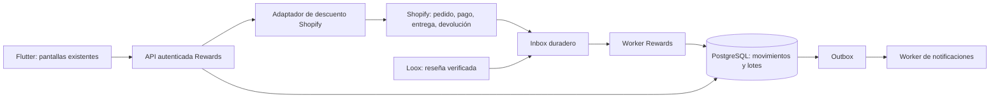

# Monetta Rewards V1 — plan de producto, arquitectura e implementación

Estado: propuesta para ejecución; no implementada. Revisión: 12–13 de septiembre de 2026, America/Monterrey. Este documento incorpora el mensaje de Miguel y la inspección del repositorio, CLI, infraestructura y administrador de Shopify. No se recibió un blueprint adicional: la lámina original describe puntos/niveles y queda sustituida en ese aspecto por el nuevo requerimiento.

## 1. Decisión de producto

Monetta Rewards será saldo promocional denominado en pesos, integrado en Home, Producto, Mi Cuenta, Mis Pedidos, Checkout y Notificaciones. Se eliminan de la propuesta original la pantalla independiente de Rewards, niveles, medidores de puntos y equivalencias punto/peso. No eliminar otras capacidades de Mayoreo.

Reglas expresadas por Miguel:

- Menudeo genera 3% de la compra elegible.
- La ganancia queda pendiente y se libera después de entregar el pedido.
- El canje máximo es 20% del subtotal elegible de una compra posterior.
- Cada saldo vence 12 meses después de su liberación.
- Bonos: $50 por primera compra con mínimo; $20 por reseña verificada; $50 para cada participante de un referido que complete una compra elegible.
- Mayoreo no genera Rewards en V1.
- Estados visibles: pendiente, disponible, utilizado, expirado y revertido.
- Cancelaciones y devoluciones deben producir ajustes automáticos.

Confirmado por Alexis: no están definidos los mínimos de primera compra/referidos ni si el mayoreo podrá canjear saldo. Son parámetros pendientes, no importes que el implementador deba elegir.

Propuesta adicional a confirmar: saldo no transferible ni retirable en efectivo; denominación MXN; canje requiere identidad Shopify verificada. Estas propiedades no se deben anunciar como términos definitivos antes de acordarlas.

## 2. Estado actual comprobado

| Área | Evidencia | Implicación |
|---|---|---|
| Shopify producción | CLI `store list` confirmó `fakcei-n9.myshopify.com`, Shop 72391655575. El administrador redirige a `monetta-2`, dominio Monetta `monetta.mx`. | Identidad de producción verificada. |
| Plan Shopify | Administrador, Configuración → Plan: **Basic**. | No diseñar la solución suponiendo Shopify Plus. |
| Acceso CLI | La organización y tiendas son accesibles; `store auth list` no devuelve sesiones de Admin API. `store execute` no pudo consultar producción. | Para pruebas API se requiere autenticación con los permisos pertinentes. La lectura del plan se completó por la sesión existente del administrador web. |
| Logística | Configuración muestra cuentas de transporte: Ninguno; entrega local activa. Un pedido entregado con DHL Express tiene en su cronología una actualización de entrega originada por seguimiento del transportista. | Existe al menos una fuente real de entrega en Shopify. No inferir que todos los transportistas y la entrega local tienen la misma cobertura. |
| Loox | Instalado. Su pantalla Your plan muestra **Beginner**. Generate API key y Add endpoint están deshabilitados. | El bono automático por reseña requiere habilitar acceso autorizado o cambiar la integración. |
| Backend | `services/accounts_orders`: Node/TypeScript, Express y PostgreSQL, migraciones SQL 001–012, autenticación de cliente Shopify, espejo de pedidos y administración. | Ampliar este servicio; no crear un backend paralelo para saldos. |
| Infraestructura activa | Fly: `monetta-accounts-staging`, una máquina `app` iniciada, 256 MB. Consulta al proceso confirmó tienda staging y `NOTIFICATIONS_ENABLED=false`. | El servicio inspeccionado no es un backend Rewards de producción ni tiene worker de notificaciones activo. |
| Producción backend | `shopify.app.production.toml` todavía contiene placeholders. La organización Fly consultada solo listó la app staging. | Hay trabajo de despliegue/configuración; esto no demuestra ausencia de servicios en otras cuentas/proveedores. |
| Pedidos | `orders_mirror` guarda totales, moneda, estados, tags y atribución. Los payloads tipados no incluyen líneas, impuestos, asignaciones de descuento ni devoluciones detalladas. | El total actual no basta para calcular Rewards de forma correcta. |
| Webhooks | Handlers de `orders/create` y `orders/updated`; verificación HMAC, control por ID de webhook y orden temporal del espejo. | Reutilizable, pero sin motor de Rewards ni eventos específicos de entrega/reembolso. |
| Recuperación | El registro de webhooks conserva identificadores y hash; no contiene un payload completo para reproducir autónomamente todos los efectos. Los efectos usan repositorios separados del claim. | Se necesita inbox recuperable y transacciones propias del ledger, además de idempotencia por negocio. |
| Checkout | `CartController` ya gestiona códigos; el coordinador reconcilia carrito e identidad y abre Shopify. | Insertar cotización/reserva/canje antes de presentar el checkout, conservando la reconciliación. |
| Reseñas | Flutter consume widget público Loox para visualización. | No utilizarlo como autoridad para conceder dinero a una cuenta. |
| Notificaciones | Hay FCM, preferencias, campañas y worker, con tipos enfocados en productos/promociones. | Añadir eventos de saldo dirigidos a una cuenta y sus preferencias específicas. |
| UI en curso | Ya existen archivos nuevos de bienvenida, componentes boutique y modificaciones de A/B. No se encontraron implementaciones de Rewards en los módulos revisados. | Integración incremental y propiedad de archivos; no sobrescribir el rediseño en curso. |

Archivos base: `lib/app/cart_controller.dart`, `lib/app/shopify_checkout_coordinator.dart`, `lib/features/checkout/checkout_screen.dart`, `lib/data/repositories/order_history_repository.dart`, `lib/data/customer_auth/customer_orders.dart`, `lib/data/reviews/loox_reviews_repository.dart`, `services/accounts_orders/src/api/server.ts`, `src/webhooks/handlers.ts`, `src/db/pgWebhookEventsRepository.ts` y `src/engagement/`.

## 3. Decisiones comerciales pendientes y propuesta calculable

El equipo puede implementar contratos y pruebas parametrizadas mientras se cierran estas decisiones. No activar los bonos con valores arbitrarios.

| Decisión | Propuesta para discutir |
|---|---|
| Subtotal elegible | Líneas de mercancía elegible, después de descuentos comerciales y antes del canje; excluir envío, propinas, tarjetas de regalo y otros conceptos no elegibles. Definir explícitamente tratamiento de IVA, incluidos precios que ya lo contienen. |
| Base que genera 3% | Importe elegible después de promociones y del saldo utilizado. Evita generar ganancia sobre el propio incentivo. Requiere acuerdo de Miguel. |
| Compras con saldo | Siguen ganando 3% sobre la base neta acordada; no sobre envío ni conceptos excluidos. |
| Mayoreo | Detectar por condiciones y descuentos realmente aplicados en Shopify, no por un booleano enviado por el teléfono ni solo por cantidad. Proponer excluir también canje en V1, sujeto a decisión pendiente. |
| Carritos mixtos | Definir elegibilidad por línea; si se simplifica V1 a compras totalmente elegibles, acordarlo expresamente y garantizar esa restricción en checkout. |
| Primera compra | Primera compra histórica elegible del cliente, no primera compra registrada desde que se instaló la app. Definir qué pasa si la primera compra histórica no alcanza el mínimo. |
| Bonos acumulables | Decidir si primera compra, referido y reseña pueden coincidir. Evaluar su costo conjunto con el 3%. |
| Referidos | Una atribución por invitado, sin autoreferidos. Proponer bonos pendientes tras pago y disponibles tras entrega, nunca al abrir el enlace. Definir ventana de atribución y compra mínima. |
| Reseñas | Proponer una recompensa por producto comprado y pedido, con límite por pedido/campaña a acordar. Debe ser compra verificada; la recompensa no depende de una calificación positiva. |
| Entregas parciales | Proponer liberar por líneas efectivamente entregadas; bonos de primera compra/referido tras completar la entrega elegible. |
| Invitados/canales | Definir si acumulan compras web, app, POS y apartados. Usar customer ID verificado para asignar saldo; nunca unir cuentas automáticamente por correo no verificado. |
| Retroactividad | Proponer acumular solo desde activación del programa, conservando antecedentes históricos para determinar primera compra y referido. |
| Vigencia | 12 meses calendario desde `released_at`, no desde pago, creación de pedido o fecha en que se consultó la app. Definir zona y comportamiento de fechas de fin de mes. |
| Devolución de canje | Definir devolución proporcional del saldo usado y vigencia restaurada. Propuesta: conservar origen/vencimiento; una prórroga por causa operativa exige una política explícita. |
| Saldo gastado y luego revertido | Proponer compensar saldo disponible y, si no alcanza, registrar un ajuste negativo que compense futuras ganancias. No cargar dinero automáticamente al cliente. |

Fórmulas propuestas, en centavos enteros:

```text
S = subtotal elegible antes de Rewards, según política fiscal/comercial acordada
A = disponible vigente menos reservas de otras operaciones
Rmax = min(A, floor(S × 20 / 100))
R = importe aceptado por cliente, servidor y Shopify, con 0 <= R <= Rmax
G = redondeo_de_política((S - R) × 3 / 100)
```

No usar float/double para contabilidad. Guardar la distribución por línea, incluyendo residuos de redondeo, para que la suma de parciales coincida exactamente con el pedido.

Ejemplo, suponiendo bases elegibles ya calculadas y sin bonos: compra de $1,800 → $54 pendientes → entrega → $54 disponibles. Con saldo $184 y nuevo subtotal elegible $900, el máximo es $180 y quedan $4. Bajo la propuesta de base neta, esa nueva compra genera $21.60, pendientes hasta su entrega. El ejemplo de $180 no implica redondear siempre a múltiplos de diez.

## 4. Canje en Shopify Basic: primera prueba obligatoria

El saldo nativo de Shopify no resuelve directamente el requisito de elegir hasta 20%: su documentación no permite seleccionar una cantidad parcial de store credit. [Fuente oficial](https://help.shopify.com/en/manual/customers/store-credit).

Las Functions privadas requieren Plus; las apps públicas con Functions pueden funcionar en otros planes. Las extensiones de UI en los pasos de información/envío/pago también requieren Plus. La selección visual de saldo puede vivir en el precheckout Flutter actual; eso no sustituye la validación del importe dentro de Shopify. [Functions](https://shopify.dev/docs/api/functions/latest), [Checkout UI](https://shopify.dev/docs/api/checkout-ui-extensions/latest).

### Opciones y criterio de selección

1. **Prueba acotada de cupón único sobre Basic.** Un importe fijo reservado, comprador específico, un uso, vencimiento corto, productos elegibles y combinaciones controladas. Shopify ofrece contexto de comprador, uso máximo y mínimo de compra. Un cupón fijo R con mínimo 5R solo es candidato cuando el mínimo de Shopify corresponde realmente a S. [Modelo del cupón](https://shopify.dev/docs/api/admin-graphql/latest/input-objects/DiscountCodeBasicInput).
2. **App pública compatible que ejecute la regla en checkout.** Si los códigos normales no garantizan los casos reales, evaluar un proveedor con Functions y API que permita identidad, reserva, importe máximo, exclusiones, cancelación y conciliación con nuestro ledger. No hay proveedor seleccionado ni compatibilidad asumida. Evitar dos sistemas que emitan saldo por la misma compra.
3. **Function propia con cambio de distribución o plan.** Otra opción es publicar una app con el proceso de revisión correspondiente, o contratar Plus. Son decisiones de costo y alcance; no actualizar el plan automáticamente ni prometer que una app privada funcionará en Basic.

La propuesta es mantener Basic y resolver primero una prueba del adaptador de canje. La decisión final depende de pruebas en el plan real; una tienda de desarrollo con capacidades adicionales no demuestra compatibilidad en producción Basic.

**No autorizar el canje solo porque Flutter calcule 20%.** Tras abrir Shopify el cliente puede cambiar cantidades, quitar productos, añadir artículos excluidos, aplicar promociones o cambiar de cuenta. El backend ya no puede asumir que el carrito original permanece intacto. Un mínimo sobre subtotal total puede ser incorrecto para un subconjunto de líneas elegibles.

Si no se logra garantizar el límite y las exclusiones en el checkout definitivo, el canje sigue apagado y no se lanza el programa como completo. No usar una corrección posterior del ledger para justificar descuentos indebidos ya concedidos.

También hay que acordar si Rewards se representa comercialmente como descuento. Ese mecanismo modifica los importes sobre los que Shopify calcula totales e impuestos; la presentación y las reglas contables deben ser coherentes con el mecanismo elegido.

### Protocolo de canje propuesto

1. El cliente solicita una cotización autenticada para un carrito. El servidor obtiene/verifica precios, descuentos, identidad y elegibilidad; no acepta un subtotal declarado por Flutter.
2. Devuelve `quoteId`, revisión del carrito, disponible, subtotal elegible, máximo canjeable, estimación de ganancia, motivos de exclusión y vencimiento de la cotización.
3. Al aceptar, bloquea transaccionalmente la cuenta y reserva lotes vigentes que vencen primero. Una clave idempotente evita dos reservas por doble toque.
4. Provisiona el instrumento de descuento con una operación recuperable. La llamada a Shopify queda fuera de una transacción SQL larga; usar outbox/operación registrada y compensaciones.
5. Aplica el descuento y vuelve a reconciliar. Un cambio de carrito o de cuenta invalida la cotización y exige recalcular. Invalidar también el checkout precargado.
6. Al crearse un pedido con ese canje, vincularlo y conservar un compromiso aunque el pago sea diferido. Al confirmarse el pago, registrar el importe realmente aplicado como utilizado. No liberar el saldo por el simple cierre de la app.
7. Si el checkout queda abandonado, invalidar el instrumento y comprobar que no fue utilizado antes de liberar la reserva. Un TTL local no basta: contemplar pedidos/webhooks demorados y conservar estados de incertidumbre hasta conciliar.
8. Si el descuento aplicado es menor que la reserva, consumir lo real y liberar la diferencia tras verificación. Un exceso es una violación que debe impedirse en checkout, no convertirse en saldo negativo por sorpresa.

## 5. Arquitectura y estados

Ampliar `services/accounts_orders` con un módulo `rewards`. PostgreSQL es la autoridad del saldo; Shopify lo es de pedidos, pagos y descuentos; los eventos logísticos verificables lo son de entrega. Flutter solo presenta y solicita operaciones.



Estados de negocio: `pending`, `available`, `used`, `expired`, `reversed`. Estados técnicos separados para canjes: `quoted`, `reserved`, `provisioning`, `applied`, `order_committed`, `settled`, `releasing`, `released`, `reconciliation_required`.

No representar toda la cuenta mediante un único estado: un lote de $54 puede tener $20 usados y $34 disponibles. Registrar movimientos inmutables y asignaciones entre lotes, pedidos y canjes. Las correcciones generan asientos compensatorios, no borran el historial.

Invariantes:

- Una misma compra, reseña o referido no concede dos veces, aunque llegue por distintos webhooks.
- Dos dispositivos no pueden reservar el mismo saldo.
- Un saldo pendiente, vencido, revertido o reservado no se ofrece para otro canje.
- Un pedido de mayoreo no acumula; su identificación procede de datos comerciales verificables del servidor.
- Reembolso, cancelación y cierre de devolución que representan el mismo efecto económico no producen tres reversiones.
- Todas las ganancias guardan versión de reglas y origen para no cambiar retroactivamente al editar configuración.
- Las notificaciones fallidas no afectan el saldo ni la posibilidad de conciliarlo.

## 6. Migraciones y modelo de datos

Usar migraciones aditivas numeradas después de las existentes; un único propietario asigna el siguiente número disponible. No editar migraciones ya aplicadas ni recrear la base.

| Grupo | Estructura propuesta | Propósito |
|---|---|---|
| Política | `rewards_program_versions` | Porcentajes, mínimos todavía desactivados, exclusiones, fechas y reglas de bonos versionadas. |
| Cuenta | `rewards_accounts` | Identidad canónica tienda/cliente/moneda, estado y versión de concurrencia. No identificar por email. |
| Movimientos | `rewards_ledger_entries` | Importes en centavos, tipo, origen, clave idempotente, evento causante, reversión asociada y actor. |
| Lotes | `rewards_credit_lots` | Ganancias por origen, liberación, vencimiento y proyección de remanente. |
| Canje | `rewards_redemptions`, `rewards_lot_allocations` | Reserva, carrito/revisión, instrumento Shopify, pedido final y consumo por lote. |
| Pedido | Snapshot por pedido y líneas elegibles | IDs de línea/variante, cantidades, impuestos, descuentos distribuidos, clasificación comercial y ganancias. |
| Entrega/devolución | Eventos normalizados y asignaciones por línea | Evidencia de entrega, cantidades devueltas y efecto económico acumulado. |
| Bonos | `rewards_bonus_claims`, `rewards_referrals` | Primera compra, reseña única, invitador/invitado y compra calificadora. |
| Procesamiento | Inbox/outbox recuperables | Eventos mínimos necesarios, reintentos, bloqueo, disponibilidad y errores inspeccionables. |
| Operación | Auditoría y ajustes | Motivo, operador, correlación y compensación, sin edición directa de balance. |

Claves únicas por tienda + cuenta + origen + regla; índices en trabajos pendientes, vencimientos, pedido y movimientos de cuenta. Bloqueos por cuenta/lotes con orden estable; mantener reservas y asiento en la misma transacción.

Plan de migración:

1. Registrar versión de base y respaldo verificable; probar restauración en entorno aislado.
2. Aplicar migraciones aditivas compatibles con la versión anterior de la app.
3. Normalizar IDs Shopify canónicos sin fusionar identidades ambiguas; poner excepciones en revisión.
4. Importar antecedentes para identificar clientes con compras previas. Eso no implica conceder saldo retroactivo.
5. Probar casos desconocidos: no afirmar “primera compra” solo porque el espejo está vacío.
6. Ejecutar cálculo en modo sombra, comparar con pedidos fuente y revisar diferencias.
7. Habilitar clientes piloto y después el programa completo.

El acceso histórico de Admin API está limitado por defecto a 60 días; recuperar compras anteriores puede requerir `read_all_orders` con aprobación o un resumen histórico autoritativo/importación controlada. [Scopes oficiales](https://shopify.dev/docs/api/usage/access-scopes).

Flutter no necesita una base local para contabilizar. Empezar con consulta/caché en memoria por cuenta. Si se agrega caché Drift de lectura, migrarla por separado, guardar frescura y limpiar al cambiar sesión; nunca permitir canje offline ni presentar un error de carga como saldo cero.

## 7. Eventos, entrega, cancelaciones y devoluciones

Agregar según disponibilidad y permisos: pago de pedido, cancelación, reembolsos, preparación/actualización logística, eventos de entrega y devoluciones procesadas. Conservar `orders/updated` como reconciliación, no como sustituto de todos los eventos.

`fulfillment_events/create` requiere `read_fulfillments`; leer `DELIVERED` y su fecha efectiva. [Eventos oficiales](https://shopify.dev/docs/api/admin-graphql/latest/enums/WebhookSubscriptionTopic), [FulfillmentEvent](https://shopify.dev/docs/api/admin-graphql/latest/objects/FulfillmentEvent).

Prueba logística: usar evidencia de DHL ya observada para verificar la consulta API y correlación pedido → fulfillment → líneas → evento entregado. Validar otros transportistas usados realmente. Para entrega local, definir un evento confirmado por la operación y auditado. No sustituir entrega por `FULFILLED`, correo enviado, fecha estimada o confirmación del comprador sin verificación.

Casos de reversión:

- Cancelación antes de liberación: revertir pendiente una vez.
- Devolución parcial: recalcular lo que todavía califica con las cantidades y descuentos originales; aplicar la diferencia, no volver a calcular 3% sobre el total bruto reembolsado.
- Devolución total: revertir la ganancia y bonos dependientes del pedido según política.
- Pedido pagado con Rewards: separar la ganancia que se revierte del saldo utilizado que se restaura; no convertir ambos en devolución de efectivo.
- Bonos por mínimo: verificar si una devolución deja el pedido bajo el umbral.
- Ganancia ya utilizada: registrar compensación pendiente y bloquear nuevos canjes si corresponde; no borrar el canje histórico ni cargar una tarjeta.
- Devolución abierta: definir congelación de la parte afectada mientras se resuelve; la reversión económica definitiva debe tener un origen verificable.
- Evento tardío: no devolver a disponible un lote ya revertido; resolver a partir del estado acumulado y versiones, no de la última notificación que llegó.

El vencimiento se comprueba en cada cotización/reserva además del trabajo programado. Un worker detenido no debe permitir gastar saldo vencido.

## 8. Reseñas y referidos

Loox distingue la API pública de la Merchant API autenticada, que proporciona IDs de cliente y pedido. API/webhooks requieren Convert o Unlimited según documentación; hoy Monetta usa Beginner y sus controles están deshabilitados. No se cambió la suscripción. [Documentación Loox](https://help.loox.io/support/solutions/articles/501000356871-loox-reviews-api-and-webhooks).

Para el bono de reseña: habilitar acceso autorizado, validar origen del evento, corroborar compra y cliente, y conceder una vez por la clave acordada. Configurar validación de webhooks. Loox documenta entregas sin reintento, por lo que debe haber reconciliación periódica por Merchant API y ACK solo después de guardar el evento. No usar nombres públicos del widget para atribuir saldo. La integración alternativa debe ofrecer evidencia equivalente; una revisión manual sería una etapa operativa expresamente acordada, no la automatización terminada.

Referidos: identificador opaco, vínculo compartible, atribución fijada antes de la compra calificadora, resolución autenticada de invitado y relación con el pedido. Soportar apertura desde web y app; definir qué pasa al instalar la app después de recibir el enlace. Se puede capturar un código manualmente en Cuenta/precheckout si evita perder atribución. No requiere una nueva página de Rewards.

Evitar autoreferidos y duplicación por cuentas fusionadas; límites y señales de abuso sin bloquear automáticamente familias solo por compartir domicilio. Bonos sujetos a compra y entrega verificadas; reversión vinculada al pedido calificador.

## 9. API propuesta

Todas las rutas de cliente derivan identidad de la credencial; nunca aceptan un customer ID como autoridad.

- `GET /customers/me/rewards`: disponible, pendiente, reservado, próximo vencimiento, ajustes, estado del programa y fecha de actualización.
- `GET /customers/me/rewards/activity?cursor=...`: movimientos paginados para una sección desplegable de Cuenta.
- `GET /customers/me/orders/:id/rewards`: desglose y estado Rewards de un pedido propio.
- `POST /customers/me/rewards/quotes`: cotización del carrito con revisión y política.
- `POST /customers/me/rewards/redemptions`: reservar/canjear una cotización mediante clave idempotente.
- `POST /customers/me/rewards/redemptions/:id/release`: solicitar liberación verificada; no saldo inmediato por declaración del cliente.
- Operaciones de referido autenticadas y un punto público mínimo para resolver el código sin revelar identidad ni saldo.
- Rutas operativas con permisos específicos para consulta, ajuste y conciliación.

La vista de pedido de Shopify Customer Account permanece como fuente de la compra; Rewards se agrega por ID canónico de pedido desde este backend. No sustituir toda la historia de compras por el espejo parcial.

## 10. Infraestructura y operación

Reutilizar servicio Node y PostgreSQL. No se justifica incorporar Redis/Kafka o un microservicio adicional en V1 si una cola SQL cubre la carga real.

Necesario:

- Configuración de backend Rewards de producción aislada de staging, con dominio HTTPS, secretos, base y permisos propios.
- Worker duradero de Rewards para entregas, vencimientos, conciliación y recuperación de instrumentos de descuento.
- Outbox y worker de notificaciones activado y supervisado; las campañas actuales requieren adaptación para eventos de cuenta.
- Permisos Shopify para lectura logística y escritura/lectura de descuentos si se elige ese adaptador; evaluar devoluciones e historia según operaciones concretas. Pedir solo lo requerido y completar reautorización.
- Credenciales Loox exclusivamente en backend cuando se habilite la integración.
- Backups y recuperación a un punto en el tiempo según el plan real del proveedor de PostgreSQL; probar restore y definir retención.
- Métricas: retraso de entrega→liberación, saldos pendientes envejecidos, reservas atascadas, diferencias con Shopify, reversiones, errores API y cola de notificaciones.
- Herramienta administrativa dentro del panel existente: consulta de movimientos, ajustes con motivo, conciliación y revisión de excepciones. No construir otra aplicación administrativa.
- Integración de exportación/supresión de datos con las rutas existentes, conservando los registros económicos que correspondan mediante política de retención y desvinculación; no borrar cascadas sin diseño.

Costos a presupuestar, sin inventar cotización: worker/base/backups, acceso Loox compatible, eventual app pública de descuentos, observabilidad y operación. Plus no es requisito de partida ni compra autorizada. La memoria y número de máquinas se deciden con medición, no copiando sin prueba los 256 MB de staging.

Un interruptor puede detener nuevos canjes o nuevas emisiones de bonos por separado. Aun con el canje pausado deben seguir funcionando conciliación, reversiones, consultas y cumplimiento de compromisos existentes. Un rollback no elimina el ledger ni ignora cupones emitidos.

## 11. Diseño en pantallas existentes

Usar los tokens boutique que están implementando A/B y resolver su adopción global con el orquestador. Marfil, negro y dorado discreto; no medidores, niveles, monedas animadas ni balances inventados. Las fotos pendientes de Miguel se gestionan aparte y no bloquean la arquitectura Rewards.

| Pantalla/paquete | Ajuste |
|---|---|
| Home — A | Tarjeta breve después del bloque comercial principal: “Tienes $184 Monetta disponibles”; secundario “$54 pendientes de entrega”. Sin sesión: explicación del beneficio cuando el programa esté activo. No prometer bonos cuyo mínimo siga indefinido. |
| Búsqueda/listados/marcas — B | Conservar el diseño y precios. No llenar cada tarjeta con cifras Rewards ni duplicar la fórmula en ProductCard. Puede recibir una etiqueta opcional de elegibilidad de una fuente común si luego se aprueba. |
| Producto — C | Debajo del precio: “Podrías ganar $54 Monetta”. Marcar como estimación y recalcular con variante y promociones; no afirmar ganancia definitiva antes del pedido. |
| Bolsa/Checkout — D | Disponible, máximo utilizable y toggle “Usar $180 Monetta”; explicación breve del límite. Mostrar reserva/aplicación en curso y total devuelto por Shopify. Si cambian condiciones, pedir aceptación del nuevo importe. |
| Confirmación — D | “Generaste $54 Monetta pendientes. Se liberan al entregar tu pedido”. Solo después de confirmación autoritativa; mientras tanto mostrar verificación. |
| Mi Cuenta — E | Bloque disponible/pendiente, próximo vencimiento y movimientos desplegables. “Invitar” dentro de Cuenta. Sin nueva página de Rewards. |
| Mis Pedidos — E | Ganado, pendiente/liberado y usado por pedido; explicación de ajustes por devolución. Estado vacío/error independiente del estado del pedido. |
| Notificaciones — E | Avisos de liberación, vencimiento próximo, ajustes y bonos. Abrir Cuenta o el pedido correspondiente, sin crear una ruta Rewards nueva. |
| Mayoreo — F | Informar que no genera Rewards. Canje pendiente de decisión, sin asumir permiso ni prohibición definitiva. Eliminar puntos/niveles del alcance anterior de F. |

La app debe distinguir saldo cero, no autenticado, programa desactivado, datos desactualizados y servicio no disponible. No mostrar un dato almacenado como autorización de canje.

## 12. Ejecución coordinada

No se lanzaron agentes de implementación en esta revisión. Propuesta: tres agentes activos y un orquestador, por tandas.

**Etapa 0 — viabilidad y reglas.** Orquestador cierra decisiones con Miguel. Un agente prueba canje en Basic; otro valida eventos de entrega/permisos/datos; otro especifica ledger y casos de negocio. Pueden producir contratos en paralelo sin otorgar dinero real. La salida es una decisión documentada del adaptador y políticas calculables.

**Etapa 1 — fundamento.** Agente R1 es propietario de migraciones, ledger, lotes y reservas. R2 implementa adaptadores Shopify/entrega/reembolsos y cotización. R3 implementa componentes/cliente Flutter contra contratos. El orquestador integra los cambios de A–F; los agentes de Rewards no editan concurrentemente sus pantallas.

**Etapa 2 — incentivos y operación.** Sobre los contratos estabilizados: R1 bonos/referidos; R2 Loox y conciliación; R3 notificaciones y herramientas administrativas. Un solo propietario modifica enums y migraciones compartidas.

**Etapa 3 — integración y lanzamiento.** Incorporar bloques en A/C/D/E; F recibe regla de exclusión. Ejecutar modo sombra, pruebas extremo a extremo, piloto y lanzamiento cuando todos los requisitos V1 acordados estén listos. Implementar por etapas no equivale a omitir bonos del alcance final sin acuerdo.

Propiedad central: `main.dart`, configuración, migraciones, scopes/webhooks, infraestructura y publicación. Respetar los cambios de otras sesiones; fijar una base de integración y usar ramas/worktrees aislados sin perder cambios no confirmados.

## 13. Pruebas y criterio de lanzamiento

Casos obligatorios:

1. 3% correcto; promociones, IVA según política y exclusiones por línea.
2. Pago crea pendiente; preparado/enviado no libera; entrega confirmada sí.
3. Pago o entrega duplicados y eventos fuera de orden no duplican saldo.
4. Entregas y devoluciones parciales con redondeo consistente.
5. Cancelación y refund del mismo pedido no revierten dos veces.
6. Dos dispositivos/doble toque: nunca se compromete más saldo del disponible.
7. Carrito editado dentro de Shopify, artículos excluidos, promociones adicionales y cambio de cuenta: no se supera 20% ni la reserva.
8. Checkout abandonado, pago diferido, respuesta API perdida y webhook tardío: no hay doble gasto ni reservas liberadas prematuramente.
9. Vencimiento a 12 meses calendario, fin de mes y reserva cercana al vencimiento.
10. Ganancia gastada antes de una devolución: compensación correcta y visible.
11. Primera compra histórica, referido repetido y reseña repetida: un solo bono.
12. Cliente invitado y cuenta cambiada: sin cruce de saldos ni atribuciones inseguras.
13. Mayoreo: no acumula; canje responde a la regla que se acuerde.
14. API Loox/webhook perdido: reconciliación recupera la reseña sin pagar dos veces.
15. Worker/FCM caídos: saldo correcto y recuperación sin notificaciones duplicadas.
16. Migración, respaldo/restauración, pausa de canje y despliegue anterior compatible.

La aceptación requiere evidencia de importes y movimientos en PostgreSQL, descuentos/pedidos en Shopify y pantallas reales. Validación técnica con pruebas unitarias de reglas, integración PostgreSQL, pruebas de adaptadores y recorridos E2E controlados. No crear pedidos ni reembolsos reales como parte de esta planificación.

## 14. Próximo paso concreto

Abrir el paquete de viabilidad del canje Basic y formalizar la matriz de reglas pendientes. En paralelo, mantener A/B avanzando visualmente con puntos de integración, sin saldos ficticios ni fórmulas financieras locales. La primera decisión de infraestructura es el mecanismo verificable de descuento; después se pueden estimar y distribuir las tareas de implementación con menor riesgo de rehacer el checkout.
