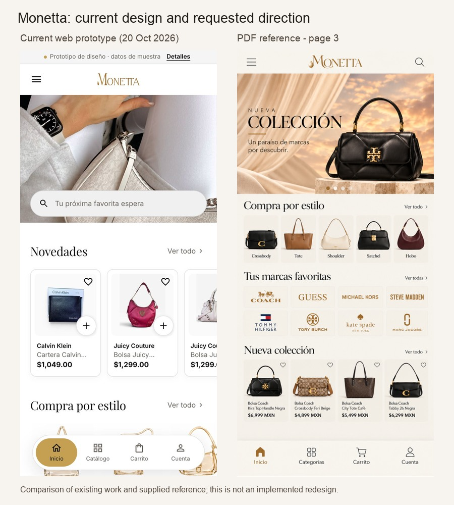

# Monetta: style guideline migration plan

Date: October 20, 2026. Status: planning deliverable; no application or theme implementation performed.

Reference: [owners' PDF](/Users/alexis_reyna/Desktop/guideline.pdf), 19 pages. Repository baseline: `c828d68` plus the existing working tree, including the uncommitted prototype and Shopify theme. [Audit evidence and check results](style-guideline-migration/2026-10-20/audit-evidence.json).

The recommended approach is to create one warm, editorial Monetta design system, apply it to the existing Flutter shopping experience, and extend the existing Shopify theme across every customer journey. Reuse the current catalog, cart, account, order, recommendation, and checkout integrations. The main work is a coordinated design migration with some missing storefront capabilities, content preparation, and a separate decision about the loyalty program.

The three delivery scenarios are **mobile: native app and Shopify**, **tablet: native app and Shopify**, and **desktop: Shopify**. Flutter web and native desktop applications are outside this plan; the repository currently targets iOS and Android.

This plan takes precedence over conflicting visual directions in the [October 17 web plan](MONETTA_WEB_REDESIGN_PLAN.md) and the earlier [web specification](web-redesign/DESIGN_SPEC.md). Keep those documents and their audit evidence as history. Their commerce and accessibility safeguards remain useful.

## 1. Current project assessment

### What is already available

| Surface | Evidence from the current tree | Implication |
| --- | --- | --- |
| Native application | Flutter iOS/Android, Shopify catalog and cart, Customer Account authentication, checkout coordinator, offline cache, recommendations, orders, notifications, favorites, and owner administration. See [repository overview](../README.md) and [app composition](../lib/main.dart). | Preserve the working product and its data boundaries. Restyle customer surfaces incrementally. |
| Native design foundations | [Shared theme](../lib/app/theme.dart) has a white editorial palette, `#AA7D44` accent, and square default controls. [Boutique layer](../lib/features/boutique/boutique_tokens.dart) adds rounded controls, neutral grey surfaces, `#C5A052` gold, Inter, and Playfair Display. Features use both layers. | Consolidate shopper tokens deliberately. Changing only one palette will leave inconsistent screens. |
| Current navigation | [Floating bottom navigation](../lib/features/navigation/monetta_floating_bottom_navigation.dart) is a rounded pill with a filled gold selection. Collection, search, account, and cart routes use compact page headers; product uses a specialized header. The side menu already supports real account identity and catalog destinations. | Full-width navigation, a consistent logo header, and updated account/menu presentation are significant shared component changes. |
| Discovery and product UI | Catalog filters, product grids, quick view, galleries, selected variants, add-to-cart errors, favorites, and purchase actions already exist. Native grids change at available widths 340, 720, and 1060. Product and account responsive tests include tablet widths. | Native tablet support is partial adaptation, with a reusable functional foundation. Define a coherent layout policy instead of adding more isolated width checks. |
| Account and Rewards | Current account uses a large dark balance card and several dashboard-style cards. Rewards DTOs and backend policy use integer MXN cents. Code explicitly records that the earlier points/tier design was replaced by a peso balance. | Account needs a substantial presentation change. Literal points and tiers require a program decision and a revised contract. |
| Web prototype | `design-prototype/` is a responsive Vite prototype with dated catalog fixtures and local cart/favorites. It has useful components, responsive CSS, browser checks, and screenshot tooling. | Use it to resolve new layouts and interaction states. Its demo commerce is not production functionality. |
| Shopify theme | `storefront-theme/` already contains `layout/monetta.liquid`, custom Monetta assets, sections, native commerce forms, and JS. Home, collection, search, product, and cart JSON templates select this layout. | Extend the existing theme. A replacement storefront architecture is unnecessary for this style migration. |
| Remaining Shopify routes | `page.mayoreo.json`, `page.contact.json`, `page.como-vender.json`, `page.json`, and `list-collections.json` still select the default Atelier layout. Blog, 404, and other supporting templates also need review. | A shopper can currently cross between different visual systems. Route coverage is part of the migration, beyond homepage styling. |
| CSS maintenance | [CSS port script](web-redesign/shopify-staging/scripts/port-css.mjs) generates theme CSS from the prototype and deliberately drops unported component families, including quick view, account, editorial, and brand sections. | Update the generator as features are ported. Editing generated theme CSS alone would be overwritten on the next port. |
| Other directories | `web/` is a screenshot gallery. `shopify/` manages the integration app. `dashboard/` and `services/catalog_monitor/` are described as retired. | These are not alternative storefront implementations. Customer design work belongs in Flutter, the prototype, and `storefront-theme/`; integration extensions may later belong under `shopify/`. |

### Production and staging are different baselines

A read-only request to [the public storefront](https://monetta.mx/) on October 20 still identifies **Atelier 3.5.0**, theme ID `149125824663`, as the main theme. Its public HTML declares Source Sans Pro body, Newsreader headings, and Inknut Antiqua accents, plus local overrides. It does not load `monetta-tokens.css`. The public navigation still sends perfume and beauty shoppers to external catalogs. This confirms that the prototype, native application, Shopify draft, and production website should not be treated as one deployed design.

The [October 19 staging delivery](web-redesign/shopify-staging/ENTREGA.md) records an unpublished Monetta draft, ID `192125304866`, on `monetta-staging.myshopify.com`. It also records incomplete collections/metafields, filters limited to availability and price, missing predictive search/favorites/quick view, and unverified integrations and devices. These are **dated staging observations**, not authenticated checks repeated in this audit. Recheck them in Phase 0 before estimating individual tickets as complete.

The theme draft's cart and checkout use its own store. Native configuration and the backend can point at different environments. A shared brand or customer email does not establish a shared cart, catalog IDs, login session, or Rewards environment.

### Checks run for this audit

| Check | Fresh result | Scope |
| --- | --- | --- |
| Targeted Flutter baseline | **67 passed** | Theme, boutique palette, floating navigation, product responsive layout, account responsive layout, onboarding, and Rewards disabled-state contract. |
| Prototype unit tests | **52 passed** | Existing local logic and navigation tests. |
| Prototype browser identity and layout | **51 passed** | 10 identity checks; five shopping pages at seven widths; five 320 px reflow checks; console/request checks. |
| Fresh visual captures | [Phone](style-guideline-migration/2026-10-20/baseline-phone.jpg), [tablet](style-guideline-migration/2026-10-20/baseline-tablet.jpg), [desktop](style-guideline-migration/2026-10-20/baseline-desktop.jpg) | Current local prototype, rebuilt during this audit. Native golden references and saved staging captures were also inspected. Native golden fixtures include media placeholders. |

The checks establish a useful existing baseline. They do not certify the new PDF design, the full Flutter suite, the Shopify draft, real devices, assistive technology, or payment completion. Logs and the browser report are retained alongside [the evidence record](style-guideline-migration/2026-10-20/audit-evidence.json).

The left image includes the prototype's demo strip; the production theme omits it. Both images are resized for comparison. The right image is the screen area of PDF page 3, with the PDF's presentation title excluded.

## 2. What the PDF establishes

All 19 pages were rendered and visually inspected. The document supplies mobile mockups rather than a complete engineering style specification. It does not define exact font families, semantic color tokens, accessible sizes, breakpoints, desktop compositions, loading/error states, or complete cart/payment screens. Most screen content is raster artwork; extracted PDF text contains mainly page titles.

The consistent direction is:

- Warm ivory and cream backgrounds, pale sand panels, subtle dividers, and restrained shadows.
- Brown primary purchase buttons, gold identity and selected states, and warm outlined secondary actions.
- Prominent serif editorial headings, product names, and account rows; simpler sans-serif supporting copy and controls.
- The original gold Monetta wordmark, fine outline icons, and a full-width bottom navigation bar with gold active icon/text.
- Product photography staged with silk, stone, warm light, and neutral backgrounds; small category tiles and brand logo panels.
- A merchandising sequence centered on styles, brands, collections, wholesale, service assurances, and contact.

The large black page titles such as "BIENVENIDA" and "PÁGINA PRINCIPAL" are presentation labels. They are not application UI to reproduce.

### Screen coverage and implementation classification

| PDF page(s) | Requested experience | Current position and required work |
| --- | --- | --- |
| 1 | Welcome | Native first-visit welcome exists. Replace campaign art/composition and CTA styling; retain persisted first-run behavior. On the web, use this visual as the homepage campaign, with direct access to shopping. |
| 2 | Personalization | Native brands/categories and skip behavior exist. Add image-based category tiles and purchase-type preference. Web preference UI/persistence is new. Selecting wholesale is a preference, not automatic pricing eligibility. |
| 3-4 | Home and continuation | Reorder modules to hero, styles, brands, new collection, campaign, popular products, wholesale, services, signup, footer. Native content model and Shopify sections need additional module types and campaign assets. |
| 5 | Search | Native search and recent/suggestion behavior exist; prototype has predictive UI. Implement real predictive Shopify search and its states, with matching warm search presentation. |
| 6 and 9 | Collection/category listing | Two treatments of the same screen family. Add editable collection/brand cover, category chips, visible count/sort, warm cards, hearts, and product action. Preserve actual filters and URL state. |
| 7 | Product preview | Native quick view is currently a draggable sheet; web prototype has it; staging delivery excludes it. Add the inset/centered presentation and native Shopify variant/cart behavior on the web. |
| 8 | Product page | Reuse gallery, thumbnails, variant selection, reviews integration, accordions, and recommendations. Change title roles, spacing, surfaces, trust rows, and CTA hierarchy. Add missing web favorites and reliable color swatches. |
| 10-11 | Wholesale | Native program and catalog sharing exist; prototype has editorial content; Shopify page remains Atelier. Build matching campaign, steps, catalog links, support strip, related products, and footer. Reconcile commercial copy first. |
| 12 | Orders | Native history/filter/detail routes exist. Restyle as compact image-led order cards. Web history is a hosted account surface; choose supported branding/extensions rather than a Liquid replacement. |
| 13 | Account | Replace native dashboard emphasis with identity, compact Rewards entry, and grouped rows. Addresses/payment entries need working hosted destinations or an explicitly scoped implementation. |
| 14 | Rewards | Existing MXN program conflicts with the PDF's points, levels, wholesale earning, and benefit catalog. Apply the new visual treatment to the current contract, or run the separate program migration described below. |
| 15 | Share and earn | Native catalog sharing exists; earning for views/shares is not supplied by that feature. Build real share/copy destinations; reward attribution and grants require a separate backend policy and capability. |
| 16 | Contact | Native verified contact channels exist; Shopify contact page remains Atelier. Add campaign, contact/group cards, and social links driven by verified destinations. |
| 17 | Purchase confirmation | Despite its page title, this is an order confirmation, not a payment form. Native confirmation exists and requires real completion evidence. Match its presentation and use Shopify's supported thank-you/order-status surfaces on the web. |
| 18 | Categories hub | Native catalog tab currently opens a product listing. Add a dedicated category/brand directory with an "All products" route. Adapt Shopify's collection index and support explicit external catalog destinations. |
| 19 | Menu | Native identity/menu behavior exists. Add warm row styling, sharing campaign, notification access, and verified social/support links. Web drawer needs the equivalent guest/signed-in states. |

The PDF does not show a full cart or payment-entry flow. Extend the current cart styling and existing hosted checkout journey to complete those states.

## 3. Proposed style foundations

These are implementation starting values, **not exact token declarations from the PDF**. Screen backgrounds vary and include gradients; final values and typography need a review of original assets and the first component board.

### Color and geometry

| Semantic role | Starting proposal | Application |
| --- | --- | --- |
| Canvas | `#FBF8F2` | Main light page ground. |
| Surface | `#FFFFFF` | Raised/readable form and content surfaces. |
| Warm surface | `#F3EADF` | Brand/category tiles, service and campaign panels. |
| Main text | `#211B16` | Headings, prices, primary copy. |
| Muted text | `#73665D` | Supporting copy; verify every actual background pairing. |
| Primary action | `#745237` with white text | Purchase and major conversion buttons. This is close to the sampled preview-button brown. |
| Accent text | `#805C32` | Selected navigation and readable accent links, darkened from the existing accent to work on warm panels. |
| Decorative gold | Existing `#C5A052`, subject to asset matching | Small decorative marks. Preserve the logo's own artwork and gradient. |
| Divider | `#E7DCCE` | Decorative separators; controls need sufficiently visible boundaries of their own. |
| Sale/error/success | Semantic roles retained | Warm-compatible red/green with contrast and meaning independent of color. |
| Card/control radius | 12 px cards; 10-12 px controls; pill for principal campaign/purchase actions | Consistent softened rectangles; 16-24 px preview panels. Full-width navigation has a flat outer edge. |
| Spacing and targets | 4, 8, 12, 16, 24, 32, 48, 64; 48 px interaction targets; 52 px principal controls | Use the existing rhythm and target sizes. Small visual icons keep larger hit areas. |

Introduce semantic tokens such as `actionPrimary`, `onActionPrimary`, `surfaceWarm`, `borderControl`, and `navigationActive`. A broad replacement of every black or grey value would also change text, media, disabled states, and administration unintentionally.

An initial contrast calculation gives white on the proposed primary action 6.99:1. The existing `#8F6838` accent reaches only 4.20:1 on the proposed warm surface, so use the darker accent-text role for small labels there. Final components still need checks against their actual backgrounds and states.

Create a small versioned token manifest, proposed at `design-system/monetta.tokens.json`, with a generation/check step for Flutter and CSS. Adapt `MonettaColors` and `BoutiquePalette` to that source while consumers migrate. Emit the web values into the existing token pipeline and regenerate Shopify assets with the port script. Keep theme-specific fixes in `monetta-theme.css`.

### Typography

Retain the bundled **Playfair Display + Inter** pair as the initial implementation choice. The PDF visually supports a serif/sans pairing but does not prove these exact families. If the owners supply a different licensed font, replace it during foundation work before screenshot baselines are accepted.

| Role | Mobile | Tablet | Desktop |
| --- | --- | --- | --- |
| Campaign headline, serif | 28-34 px | 36-42 px | 44-56 px |
| Screen/editorial title, serif | 24-28 px | 28-32 px | 32-40 px |
| Section title, serif | 22-24 px | 26-28 px | 28-32 px |
| Product detail/preview name, serif | 24-26 px | 28-30 px | 30-34 px |
| Reading copy, sans | 14-16 logical px native; 16 px web | 16 px | 16-18 px |
| Card labels and prices | 13-16 px, according to role | 14-18 px | 14-18 px |
| Control labels, sans | 14-16 px | 14-16 px | 14-16 px |

Add distinct roles for product name, editorial heading, account row, navigation label, and price. Current `boutiqueTitle` and product helpers use Inter; changing their family globally would also change controls and unrelated headings. Allow long product names and text scaling to increase height. Do not copy the mockup's very small type or force four unreadable product cards into a phone viewport.

### Photography, assets, and motion

Obtain original campaign artwork and unflattened copy, category cutouts, approved brand logos, and the welcome composition. PDF screenshots are review references; they are unsuitable as final full-screen UI images. Keep headings, prices, controls, and offer text as real text wherever possible.

Prepare a tall native welcome image, phone campaign crop, tablet crop, and wide desktop campaign composition with explicit focal points. Use responsive sources on Shopify and bounded image requests in Flutter. Preserve actual product photography and product colors. A tall existing hero image does not provide enough information for a clean desktop landscape composition.

Reuse the existing 180/280/480 ms motion rhythm where appropriate. Keep primary content visible immediately, provide reduced-motion behavior, and use a static initial hero. If a campaign carousel is needed, provide labeled controls and pause behavior; animation is not required to achieve this style.

The PDF defines a light appearance. Apply warm colors to light mode and retain a functioning dark palette while mapping the new component geometry/type roles. Add dark regression coverage to avoid breaking an existing setting; a new art-directed dark identity is a separate design task.

## 4. Three responsive scenarios

Use shared layout names and tokens across channels. The proposed web bands preserve the prototype's familiar **768 / 1024** transitions. Native tablet layouts should use available logical width and orientation, not a device-name check. Audit current Flutter 720/1060 grid rules before adopting or replacing them. Grid columns depend on the width remaining after gutters and sidebars.

| Rule | Mobile / compact: 320-767 | Tablet / medium: 768-1023 | Desktop / expanded: 1024+ |
| --- | --- | --- | --- |
| Channels | Native iOS/Android and Shopify web | Native iOS/Android tablets and Shopify web | Shopify web; expanded native layouts also apply to large tablets |
| Content gutter | 16-20 px | 24-32 px | 40-48 px, maximum content width 1440 px |
| Product listing | Two columns when each card remains readable; one at narrow/reflow sizes | Three columns | Three at compact desktop widths; four when available grid width supports roughly 200-208 px cards |
| Category hub | Three columns at ordinary phone sizes; two when needed | Four columns | Five or six columns within the content container |
| Filters | Accessible sheet/drawer | Touch-friendly drawer | Approximately 240 px sidebar when it fits, usually from 1200 px; drawer otherwise |
| Product detail | Gallery, thumbnails, information, actions, details, recommendations | Stacked at narrower widths; approximately 55/45 split from around 900 px if the information panel stays at least 320 px | Approximately 58/42 gallery and information; sticky behavior only when the panel fits vertically |
| Preview | Inset single-column modal, with a near-full-height scrollable fallback | Centered panel, maximum about 720 px; split when readable | Centered gallery/information modal, approximately 880-960 px maximum |
| Cart | Full-width page/sheet; one visible checkout action region | Drawer plus full page; summary follows content unless a split fits | Cart page with an approximately 340-400 px summary column; cart drawer for quick review |
| Footer | Stacked groups or accessible disclosure groups | Two-column grouping | Newsletter/service strip and multi-column links |

### Scenario A: mobile

The native app should feel closest to the supplied screens. Mobile Shopify should share the same components and hierarchy while allowing visitors to open product/collection URLs directly.

1. **Shell:** warm logo header with menu/search and clear back behavior on interior routes. Retain page titles and accessibility landmarks even when the logo occupies the visible header. Replace the floating pill with a full-width safe-area navigation surface: Inicio, Categorías, Carrito, Cuenta. Route the Categories tab to the new directory, with All products one tap away.
2. **Home:** put campaign, styles, brands, and new collection in the reference order. Use swipeable product rails with readable cards and a visible next-card cue; use larger category tiles rather than shrinking text. Follow with the second campaign, popular products, wholesale, services, signup, and footer.
3. **Browsing:** collection art has a bounded height, followed by chips, count, sort, and products. Keep filter state and scroll position when returning from a product. Hearts and preview actions have separate, labeled touch targets.
4. **Product:** main photo, accessible zoom, thumbnails, serif name, real price/discount, real variant choices, service facts, primary add action, secondary buy-now action, details, and recommendations. Keep loading, unavailable variant, add failure, and retry behavior visible.
5. **Account:** compact identity and Rewards entry, grouped rows, sharing banner, and sign-out. Keep guest, signed-in, expired-session, loading, and unavailable-service variants. Unsupported account actions need a real hosted destination before the row ships.
6. **First visit:** keep the existing optional native welcome/personalization flow. Provide skip and later preference editing. Web visitors enter shopping directly; a voluntary preference entry can reuse the campaign styling. Forcing every web visitor through native onboarding would obstruct direct product visits.

**Bottom controls need one explicit adaptation:** the PDF shows global navigation on product screens, while the current product uses a purchase dock. Proposed default: full-width navigation on browsing/account screens and a single contextual purchase/checkout bar where needed on product/cart. Keep inline actions available. Review this exception in Phase 1; if persistent global navigation is required on the product page, demonstrate how buying remains reachable without stacking two fixed bars. Preserve measured content/focus clearance in either choice.

### Scenario B: tablet

Tablet needs intentional composition and touch interactions, not an enlarged phone canvas.

1. **Native navigation:** keep the full-width bottom destinations in portrait/medium layouts. For large landscape tablets, evaluate a compact navigation rail with the same destinations. **Web navigation:** compact header with menu, prominent search, account/cart, and a scrollable category row; bottom navigation is unnecessary when those destinations are already available.
2. **Home:** compose campaigns with image and live text in separate regions when the crop needs it. Present styles/categories in a four-column grid, brand panels in a balanced grid, and three readable products per row. Keep the same content order as mobile.
3. **Product:** begin with a stacked composition at 768 px. Switch to a split only when both gallery and purchase panel have sufficient width. A portrait tablet with 200% text may correctly return to a stacked layout.
4. **Dialogs:** center preview and preference panels with clear dismissal, scrollable content, and reachable actions. Keep drawer filters large enough for touch. Avoid stretching a phone's draggable sheet to the entire tablet width.
5. **Account/orders:** use bounded content widths; native identity/navigation and order content may sit side by side in expanded layouts. Keep each order card readable. Shopify-hosted pages use their supported responsive layout and branding.
6. **Landscape/keyboard:** keep controls usable with touch, trackpad, keyboard, and the virtual keyboard. A 1024 px tablet can enter expanded layout while retaining all touch affordances.

### Scenario C: desktop

Desktop should express the same identity while making discovery and comparison more efficient.

1. **Header:** wordmark, visible search, account/favorites/cart utilities, and category/brand navigation. Menus open through keyboard and click as well as hover. Show current filters and result count without consuming most of the viewport.
2. **Campaigns:** create a wide composition with a defined image focal point and bounded live copy. Use the warm visual language across the canvas, with generous section spacing and a maximum content width. A stretched phone screenshot is not a desktop design.
3. **Catalog:** add a filter sidebar when it fits; keep three or four readable columns according to available width. Product hover can reveal an extra action, but preview and favorite remain discoverable through keyboard and touch.
4. **Product/preview:** use gallery and information side by side, with thumbnail navigation, real variants, prices, trust facts, and brown purchase actions. Make the purchase panel sticky only when its height permits full access. Long descriptions remain in the document flow.
5. **Cart:** keep editable line items and costs together with a bounded summary panel. Reuse Shopify cart behavior, server totals, discount display, and checkout handoff.
6. **Account/content:** style the theme's contact, wholesale, category, policy, and supporting routes consistently. Use supported Shopify account/checkout branding and extensions for hosted surfaces. A native-style custom account dashboard is additional platform work, not a CSS change in the theme.

At all widths, landscape or a short viewport can release sticky/fixed chrome so the page remains usable. Preserve the existing short-height, safe-area, focus visibility, and back-navigation safeguards as components change.

## 5. Capability and business decisions

### Rewards requires an explicit branch

The [current Rewards contract](redesign/REWARDS_CONTRACT_V1.md) and [backend defaults](../services/accounts_orders/src/rewards/types.ts) describe 3% retail earning, MXN cent balances, a 20% redemption limit, 12-month validity, no wholesale earning, and disabled referral/review/first-purchase incentives by default. Environment flags also control program and redemption availability. This audit did not verify their deployed values.

PDF page 14 instead shows 1 point per $300, 2 points per $300 wholesale, 50 points for sharing, silver/gold levels, and several redemption benefits. Page 15 also suggests earning on catalog views or purchases. Those are new economic and attribution rules.

- **Recommended initial delivery:** match the warm account/Rewards presentation while showing the existing monetary balance, real activity, and enabled benefits from the service. A tier gauge should appear only if there is an authoritative tier contract; otherwise use an appropriate balance presentation.
- **Literal points-program delivery:** define earning/redemption conversion, level thresholds, wholesale policy, share/view qualification, expiration, refunds/reversals, abuse limits, and treatment of existing balances. Then version the contract, migrate the ledger as needed, implement grants/redemption/attribution, add web authentication integration, and test both channels against one account. This is a separately estimated backend and product workstream.

Catalog sharing can ship independently through real links and the platform share UI. A successful share sheet or copied URL does not prove that another person viewed or purchased. Keep earning claims tied to authoritative program behavior.

### Decisions to close during foundation work

| Decision | Recommended starting position | What it gates |
| --- | --- | --- |
| Exact assets and fonts | Owners/designer provide original campaign artwork and font identification; use existing licensed pair for initial keyframes. | Final visual fidelity and desktop imagery. |
| Rewards branch | Preserve the implemented MXN program during the style release unless a replacement policy is explicitly adopted. | Literal points, tiers, incentives, and backend migration. |
| Wholesale meaning | Reconcile "3 pieces", "more than 3 pieces", and current "3 models" language; verify the actual discount/quote path. | Preference labels, campaign claims, checkout promises. |
| Shipping, delivery, and offers | Confirm newsletter free-shipping offer, threshold, exclusions, and delivery estimate. The PDF includes $1,999 and 5-7 days; current app content contains other estimates. | Service rows, signup offer, wholesale copy, confirmation copy. |
| Account destinations | Verify account version, supported payment/address management, plan capabilities, and whether a Rewards account extension is required. | Account/checkout design commitment and extension scope. |
| Shared test environment | Align native catalog, commerce, accounts, backend, and theme on the same isolated Shopify store before parity tests. | Comparable products/variants/orders and integration acceptance. |
| Catalog availability and taxonomy | Confirm which brands/categories are stocked and which lead to external catalogs; verify staging metafields and filters. | Category hub, cover content, filters, swatches, preview data. |
| Bottom action policy | Review the mobile product/cart exception described above with real content and large text. | Navigation/CTA component acceptance. |

Prices, review counts, discounts, the "last 3 pieces" message, sample account data, and order numbers in the PDF are illustrative. Read them from real sources. The current native quick-view contract specifically lacks an authoritative stock quantity; either add a verified quantity source or show availability without a numeric scarcity claim.

Use `monetta.mx` and validated route handles for links. The PDF's `monetta.com/catalogo/...` examples are not the current Shopify route map. Verify phone/social/group destinations; update the footer year dynamically. Brand marks and product titles must reflect available catalog content.

## 6. Shopify delivery architecture

### Theme-owned surfaces

Continue with Liquid JSON templates and editable sections. Shopify supports changing the look of pages through section-based JSON templates and selecting an alternate layout through the template's `layout` attribute. [Shopify JSON template documentation](https://shopify.dev/docs/storefronts/themes/architecture/templates/json-templates).

Extend `layout/monetta.liquid` and its header/footer groups to every relevant customer route. Port wholesale, contact, category index, generic content, 404, and policy rendering deliberately. Review blog/article, password, and gift-card experiences according to how the store uses them. Do not remove Atelier source or AI-generated legacy blocks until no active template depends on them.

Where a route cannot select the alternate layout, bring its shared/global layout and chrome into the same visual system through supported mechanisms. Check those routes explicitly rather than inventing unsupported template types. Hosted customer accounts and checkout remain a separate surface.

Preserve `content_for_header`, canonical/metadata output, structured product data, product forms, cart line keys, section rendering, native filtering, and app block support. Keep third-party UI in the scope of the migration: the current product section supports `@app` blocks, but the staging report did not verify Loox, Labeler, Booster, or Clarity. Test the configured production integrations in a suitable preview.

Give owners editor controls for campaign image/crop/copy/link, chosen product/collection source, brand/category tiles, wholesale banners, service copy, signup, support, and footer groups. Reuse existing home/editorial metaobjects where appropriate, with documented backward-compatible additions. Keep campaign art distinct from live product data. A category tile needs a destination type: Shopify collection, internal page, or external catalog.

Implement missing Shopify capabilities against real storefront behavior: favorites with explicit persistence scope, predictive search, quick view with actual selected variant IDs, editable cart drawer, recently viewed, and color mappings only where reliable data exists. Browser-local favorites/preferences are an acceptable first scope if labeled and documented; account and cross-device synchronization requires additional service integration.

### Shopify-hosted account and checkout surfaces

Theme CSS does not define the whole hosted account/checkout experience. Use the checkout and accounts editor to align logo, available fonts, colors, buttons, and surfaces; some branding settings apply to new customer accounts as well. Advanced options depend on the store's plan. [Shopify checkout styling guidance](https://help.shopify.com/en/manual/checkout-settings/customize-checkout-configurations/checkout-style).

Customer-account extensions can extend existing account pages or add full pages. If web Rewards or account favorites require custom authenticated pages, design them using the supported components and branding, and implement the required server authentication bridge. Do not assume mobile credentials or Liquid page markup provide the browser integration. [Customer account extension overview](https://shopify.dev/docs/apps/build/customer-accounts), [full-page extension guide](https://shopify.dev/docs/apps/build/customer-accounts/full-page-extensions/build-new-pages).

Check the actual plan before promising information/shipping/payment checkout extensions; those extension targets require Shopify Plus. Treat thank-you and order-status customization as their own supported targets. [Checkout UI extension reference](https://shopify.dev/docs/api/checkout-ui-extensions/latest).

The target is consistent brand and task completion across these hosted surfaces, with documented platform differences. Preserve actual order confirmation evidence and checkout behavior. Shared catalog/account identity can be tested; cross-channel cart synchronization is additional scope.

## 7. Implementation work packages

Paths marked "new" are proposed outputs, not files created by this planning task.

| Package | Concrete changes | Primary implementation locations |
| --- | --- | --- |
| A. Foundations | Versioned tokens, typography roles, button/input/chip/card states, warm surfaces, shopper theme adapter, dark compatibility, responsive policy. | `design-system/monetta.tokens.json` (new); `lib/app/theme.dart`; `lib/features/boutique/boutique_tokens.dart`; `design-prototype/src/styles/{tokens,base,components,pages}.css`; CSS port script and theme `assets/monetta-*.css`. |
| B. Shared shell | Full-width mobile nav, Categories destination, logo/interior headers, menu identity/sharing/support, measured clearance, tablet/desktop navigation. | `lib/features/navigation/`; `lib/features/home/home_screen.dart`; prototype `src/components/{shell,page-bar}.js` and `src/lib/chrome.js`; theme `layout/monetta.liquid`, `sections/monetta-header.liquid`, `snippets/monetta-{dock,page-bar}.liquid`, `assets/monetta-core.js`. |
| C. Campaigns and home | Welcome art, optional preference tiles/type, reference home order, campaign/service/signup modules, responsive assets and content schema. | `lib/features/{welcome,onboarding,home}/`; `lib/domain/home_content.dart`; `lib/data/shopify/home_content_repository.dart`; existing preference/profile persistence; prototype home/data modules; theme home sections and `templates/index.json`. |
| D. Categories and discovery | New category/brand hub, listing covers/chips, search states, true predictive search, filters/URL restoration, favorites and recently viewed persistence. | `lib/features/catalog/`, proposed `category_hub_screen.dart`; native favorites; prototype listing/search/facet components; theme `templates/list-collections.json`, `sections/monetta-{collection,search}.liquid`, `snippets/monetta-{card,results,listing-layout}.liquid`; new category and predictive-search sections/modules. |
| E. Product and cart | Serif detail titles, media treatments, shared preview variants, trust rows, real swatches/reviews, brown CTAs, warm cart and editable drawer. | `lib/features/product/{product_screen,quick_view,product_selection,purchase_dock}.dart`; `lib/features/catalog/product_tile.dart`; `lib/features/checkout/`; prototype product/cart components; theme product/cart sections, `snippets/monetta-cart-line.liquid`, `assets/monetta-{product,cart}.js`. |
| F. Account and service pages | Identity/row account layout, Rewards presentation against selected contract, order cards/confirmation, preferences, wholesale/contact/sharing surfaces, common layout on supporting routes. | Native `features/{account,orders,rewards,wholesale,partner,contact,notifications}/`; existing controllers/repositories; theme `templates/page*.json`, `list-collections.json`, supporting templates and new editable sections; checkout/accounts branding; `shopify/extensions/` if the extension branch is adopted. |
| G. Optional program change | Points/tier contract, ledger policy/migration, attribution, reversals, grants/redemption, authenticated web access. Scope only after the business rules are settled. | `services/accounts_orders/src/rewards/`, database migrations, `lib/features/rewards/`, corresponding contracts/tests, and account extension/backend integration. |
| H. Verification and release | New approved visual baselines, behavior regression coverage, editor/integration checks, real device/browser review, deployment mapping and rollback record. | Existing Flutter tests/goldens; `design-prototype/verify/`; `docs/web-redesign/shopify-staging/scripts/e2e/`; a new evidence folder and updated implementation documentation. |

Migrate shared components before individual screens. Keep compatibility wrappers while callers move. Preserve administrator presentation independently unless its redesign is explicitly included. Existing source comments and identity/fidelity checks that mandate white/grey surfaces, black CTAs, or the floating pill must be revised to reference the newly approved specification; behavior checks should remain intact.

The CSS port script currently removes several new component families. Expand its allow/port coverage as each family becomes production-ready and verify generated outputs. Do not maintain separate handwritten versions of the same brand tokens in Flutter, prototype CSS, and theme CSS.

## 8. Delivery phases and estimate

Planning estimate: **about 5-8 calendar weeks** with one Flutter engineer, one Shopify/web engineer, a product designer, and shared QA available, with assets/decisions supplied early. The ranges below are business-day windows for the team, allowing the native and web streams to overlap. They are not person-day totals or a delivery commitment. A single engineer implementing both channels will need a longer schedule.

| Phase | Window | Work and dependency | Reviewable exit result |
| --- | --- | --- | --- |
| 0. Baseline and decisions | 2-3 days | Recheck the authenticated draft/production configuration, capture current flows, resolve the decision table, inventory original assets and data gaps. | Route/capability inventory; chosen Rewards branch; confirmed commerce copy; asset list; same-store test plan. |
| 1. Foundations and three keyframes | 3-4 days | Define tokens and components; design home, collection, product, and account examples at 390, 834, and 1440 px; review bottom controls. | Approved component board and mobile/tablet/desktop compositions, with platform exceptions listed. |
| 2. Shared shell and components | 4-5 days | Implement theme adapters, navigation, headers, cards, buttons, dialogs, and responsive layout helpers. Start from Phase 1 artifacts. | Runnable component/shell previews in Flutter and the local prototype; generated theme styles remain consistent. |
| 3. Discovery and commerce | 6-9 days | Home, categories, collections, search, product, preview, favorites, cart, and missing Shopify interactions; content migration runs alongside UI work. | A functioning new-style browse-to-checkout handoff on native and Shopify staging across all three layouts. |
| 4. Account and complete route coverage | 5-7 days | Account/orders/Rewards presentation, wholesale/contact/sharing, signup, supporting templates, hosted branding, required account extension integration. Start the platform capability work in Phase 0. | Every PDF screen family has a working destination and state coverage; route transitions retain the same identity. |
| 5. Validation and release preparation | 4-6 days | New visual review, full relevant regression suites, real devices/browsers, configured apps and editor review, beta/preview feedback, migration/rollback rehearsal. | Release candidate with resolved blocking findings, evidence, owner-editing notes, and channel-specific rollout plan. |

The estimate covers the style migration and storefront capabilities described above using existing business rules and supported hosted account behavior. A fully custom web account experience, cross-device preferences/favorites, or a literal points/tier program needs its own estimate after Phase 0. Do not hide those projects inside the visual update.

The first milestone should be a reviewable **home + collection + product + account** set across the three sizes, backed by the new component board. That resolves the largest visual choices before the team applies them to every route.

## 9. Acceptance and rollout

### Coverage matrix

| Area | Required coverage |
| --- | --- |
| Viewports | 320, 375/390, 440, 768, 834, 1024, 1280, 1440, and 1920 px; portrait/landscape and relevant split-screen widths; verify around breakpoint boundaries. |
| Native devices | Representative iPhone and Android phone; iPad and Android tablet; verify safe areas, back gestures, virtual keyboard, larger text, and the existing appearance setting. |
| Web browsers | Real iOS Safari, Android Chrome, desktop Safari/Chrome/Firefox; keyboard and touch interactions. Existing Chromium checks remain useful but do not replace these checks. |
| Screens | Every PDF screen family, plus cart, filters, favorite list, notification/settings routes, supporting content, 404, and hosted account/checkout handoffs. |
| States | Loading/skeleton; empty; error/retry; offline/cache where supported; sold-out/unavailable variant; long title; guest/signed-in/expired session; Rewards disabled; blocked browser storage. |
| Commerce | Correct variant and price; stock refusal; quantity/remove/undo; server discounts/totals; repeat-add protection; checkout cancellation/return; confirmed-order evidence; no regression in manual wholesale/apartado behavior. |
| Owner editing | Reorder sections, change campaign copy/images/links, choose collections, update support and service content, and preview each size in the actual Shopify editor. |

### Completion criteria

- The approved warm palette, serif/sans roles, photography treatment, navigation, cards, and CTAs are consistent across customer routes. Tablet/desktop layouts have their own approved compositions.
- Every visible action has a real destination or a genuine unavailable state. Sample prices, orders, stock counts, tiers, and incentives do not become production data.
- Layouts reflow without page-level horizontal scrolling, clipped controls, hidden focus, or content underneath fixed bars. Product galleries/rails can scroll intentionally with accessible alternatives.
- Target WCAG 2.2 AA on web: adequate text/control contrast, keyboard/dialog behavior, visible unobscured focus, text resizing/reflow, semantic labels/headings, and understandable errors. Keep the project's larger 48 px targets as a product standard; do not describe that size as the WCAG AA minimum. Validate native accessibility with VoiceOver and TalkBack. [WCAG quick reference](https://www.w3.org/WAI/WCAG22/quickref/).
- Preserve the existing checkout, attribution where configured, account identity, order history, and local persistence contracts. Run backend/contract tests if those interfaces or loyalty rules change.
- Run the full relevant Flutter checks, prototype unit/browser suites, Shopify Theme Check and staging journeys after implementation. Compare inherited theme findings against the recorded baseline and resolve new findings. Rebaseline visuals against approved new designs without weakening behavior checks.
- Measure production-shaped performance before release and monitor after launch. Target field p75 LCP at most 2.5 s, INP at most 200 ms, and CLS at most 0.1, segmented by device class. Lab results are an earlier diagnostic, not a claim about field performance. [Core Web Vitals guidance](https://web.dev/articles/vitals).

### Release sequence

1. Finish visual and functional acceptance on an unpublished theme and native beta builds using aligned test environments.
2. Record the production theme/configuration backup, active integrations, route/template assignments, content migration steps, and native build/configuration mapping. Existing uncommitted work must be preserved during implementation.
3. Preview on production-shaped data; check SEO metadata/structured data, redirects, analytics events, signup, configured third-party apps, account/checkout branding, and host-specific links.
4. Release the website and native clients through their normal reviewed processes with compatible data contracts. Track which channel/style version is active; the releases need not occur at the same instant.
5. Monitor add-to-cart success, checkout progression, search/filter usage, cart failures, and crash/error rates against the pre-change baseline. Set alert and rollback thresholds from measured traffic/error rates before launch. Keep the previous theme available and native backend compatibility intact.

## 10. Source map and audit limits

| Source | Use in this plan |
| --- | --- |
| [Supplied PDF](/Users/alexis_reyna/Desktop/guideline.pdf) | Visual direction and the 19-page screen inventory. SHA-256: `7e7414def29c38c65c1ab5ce25dd5f250cc50d65db66a291d67536b45dbb97db`. |
| [Shared theme](../lib/app/theme.dart), [boutique tokens](../lib/features/boutique/boutique_tokens.dart), [font registration](../pubspec.yaml) | Existing color/type roles, dual theme layers, geometry, and licensed fonts. |
| [Navigation](../lib/features/navigation/monetta_floating_bottom_navigation.dart), [side menu](../lib/features/navigation/monetta_side_menu.dart), [catalog](../lib/features/catalog/catalog_browse_screen.dart), [grid policy](../lib/features/catalog/product_tile.dart) | Current navigation, directory gap, and responsive behavior. |
| [Quick view](../lib/features/product/quick_view.dart), [product](../lib/features/product/product_screen.dart), [confirmation](../lib/features/checkout/order_confirmation_screen.dart) | Existing selected-variant behavior, stock-data limit, and confirmation evidence. |
| [Account](../lib/features/account/account_screen.dart), [balance presentation](../lib/features/account/profile_rewards_card.dart), [Rewards contract](redesign/REWARDS_CONTRACT_V1.md), [policy](../services/accounts_orders/src/rewards/types.ts) | Current MXN program and differences from PDF points/tier screens. |
| [Wholesale content](../lib/features/wholesale/wholesale_content.dart), [home model](../lib/domain/home_content.dart), [editorial schema](EDITORIAL_CONTENT_METAOBJECTS.md), [contact](../lib/features/contact/contact_screen.dart) | Existing business copy, source-driven content, and verified destinations. |
| [Prototype README](../design-prototype/README.md), [web tokens](../design-prototype/src/styles/tokens.css), [CSS port](web-redesign/shopify-staging/scripts/port-css.mjs) | Existing responsive workflow, demo limitations, and generated-theme dependency. |
| [Shopify layout](../storefront-theme/layout/monetta.liquid), [staging report](web-redesign/shopify-staging/ENTREGA.md), [staging runs](web-redesign/shopify-staging/RUNS.md) | Local template coverage and dated remote staging observations. |
| [Audit evidence](style-guideline-migration/2026-10-20/audit-evidence.json), [Flutter log](style-guideline-migration/2026-10-20/flutter-baseline.log), [unit log](style-guideline-migration/2026-10-20/prototype-unit-baseline.log), [browser report](style-guideline-migration/2026-10-20/prototype-browser-baseline.json) | Fresh checks and precise limits of this planning audit. |

The repository was assessed as it exists in the working tree, not solely at committed HEAD. No application source, prototype source, theme source, backend policy, store settings, deployment, or commerce data was changed for this plan. Authenticated Shopify configuration, plan entitlements, deployed Rewards flags, real-device rendering, and completed payments remain implementation-phase verification tasks.
