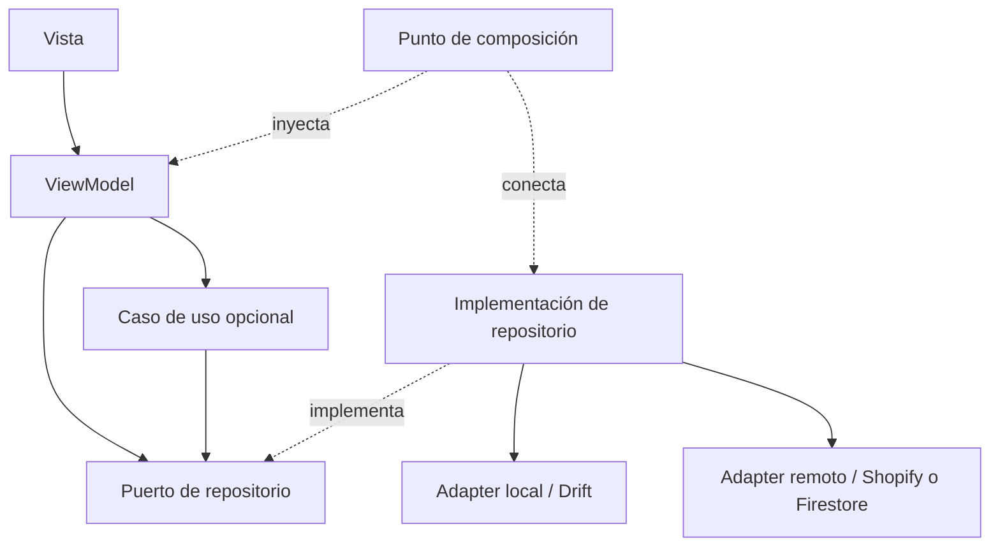

# Propuesta de reconstrucción de Monetta con MVVM

**Fecha:** 6 de octubre de 2026, America/Monterrey.\
**Estado:** propuesta para revisión por GPT Astra; no constituye una implementación ni una decisión aprobada de despliegue.\
**Referencia examinada:** checkout local de Monetta, HEAD `48a6786`, incluyendo su estado de trabajo.\
**Objetivo:** replicar las funciones vigentes y la identidad visual de Monetta con una arquitectura más clara, contratos más consistentes y pruebas de equivalencia funcional.

## 1. Recomendación ejecutiva

Reconstruir la aplicación Flutter con **MVVM por funcionalidad**, repositorios compartidos por dominio y una capa de casos de uso selectiva. Mantener el dominio independiente de Flutter y de las bibliotecas de estado. Utilizar **Riverpod como mecanismo de estado e inyección de dependencias** y **go_router como enrutador central**, sujetos a la revisión de alternativas y compatibilidad indicada en este documento.

La reconstrucción debe mejorar responsabilidades y contratos, además de la estructura de carpetas. Cambiar nombres de `Controller` a `ViewModel` sin separar las operaciones actuales no satisface el objetivo.

El backend seguirá una organización por módulos con puertos y adaptadores. MVVM corresponde a la presentación de la app; las rutas HTTP del backend se organizarán como controladores, servicios de aplicación y repositorios.

La versión nueva se desarrollará en un checkout aislado del proyecto actual, que permanecerá como referencia funcional. Se reutilizarán reglas, pruebas, contratos, recursos visuales y adaptadores cuando su comportamiento sea adecuado. Cada función se incorporará con un criterio de equivalencia verificable.

### 1.1 Resultados esperados

- Pantallas centradas en presentación y acciones del usuario.
- ViewModels con estado explícito y dependencias acotadas.
- Un responsable de escritura y una política de autoridad para cada tipo de dato.
- Reutilización de lógica real, evitando copias de clientes, validadores y componentes.
- Manejo deliberado de navegación, enlaces profundos, recursos inexistentes y página 404.
- Conservación de datos locales y compatibilidad con servicios e identidades actuales.
- Diagnóstico de fallos sin mostrar excepciones internas a la persona usuaria.
- Documentación que diferencie producto vigente, decisiones propuestas y código histórico.

## 2. Alcance y evidencia

La propuesta se basa en lectura del código, comparación de archivos y documentación del repositorio. **No se ejecutaron las suites, no se verificó infraestructura remota y no se modificaron servicios o datos de producción para elaborar este documento.** Los problemas potenciales de ejecución se distinguirán de los hechos confirmados por inspección.

El árbol de trabajo contiene cambios previos en configuración, Rewards y pruebas del servicio `accounts_orders`. Esos cambios no forman parte de esta propuesta y deberán conservarse e inventariarse al fijar la referencia de reconstrucción.

### 2.1 Producto vigente frente a código histórico

Hay una corrección importante respecto a interpretar todas las carpetas como funciones actuales: **el catálogo externo y su dashboard están retirados del producto**. El código puede seguir presente como referencia histórica. El runtime rechaza habilitar el catálogo externo y su integración automática de CI fue retirada. Véanse [el inventario de retiro][E01] y [la configuración actual][E02].

Consecuencias para esta propuesta:

- El alcance base incluye exclusivamente los productos propios de Shopify.
- No se reconstruyen scraping, feeds de terceros ni compra a proveedores.
- `dashboard/` y `services/catalog_monitor/` quedan fuera del producto nuevo, salvo una decisión posterior y explícita de reactivación.
- La 404 del dashboard se documenta como trabajo condicional, no como motivo para reactivar el servicio.
- La retirada de infraestructura viva es un proyecto operativo separado; esta propuesta no autoriza eliminar servidores, bases de datos, secretos ni despliegues.
- El panel administrativo dentro de Flutter es una función diferente del dashboard histórico y sí debe evaluarse en la matriz funcional.
- `web/` es una galería de referencias visuales; no es el storefront Shopify ni una versión web completa de la app. [Referencia][E03].

### 2.2 Hallazgos del código examinado

| ID | Hallazgo | Evidencia | Implicación |
|---|---|---|---|
| H01 | `CatalogStore` reúne catálogo, sincronización, bolsa, favoritos, historial de interacción y recomendaciones. | [CatalogStore][E04] | Separar fuentes de datos compartidas y coordinación de operaciones. |
| H02 | `main.dart` combina arranque, creación de dependencias, scopes, integración de navegación y aplicación. | [Composición actual][E05] | Crear un punto de composición y un enrutador independientes. |
| H03 | Pantallas importan `main.dart` y componentes de `data/`. | [Checkout][E06] | Reemplazar dependencias implícitas por contratos y ViewModels. |
| H04 | Parte de filtros y ordenamiento vive en widgets. | [Colecciones][E07] | Extraer funciones puras y estado de consulta. |
| H05 | El cliente HTTP de Rewards está dentro de `features/`. | [RewardsApi][E08] | Separar API, mapeo, dominio y presentación. |
| H06 | Hay cuatro archivos literalmente idénticos entre Firebase Functions y el backend de Vercel. | [Núcleo Vercel][E09], [núcleo Functions][E10] | Evitar mantener dos copias de las mismas reglas. |
| H07 | Los clientes Admin de esos dos targets ya difieren: entre otros cambios, solicitan 6 y 20 imágenes respectivamente. | [Cliente Functions][E11], [cliente Vercel][E12] | Definir contrato común y políticas explícitas por target. No asumir equivalencia operativa. |
| H08 | Identidad y pedidos repiten el descubrimiento y validación del endpoint Customer Account GraphQL. | [Identidad][E13], [pedidos][E14] | Extraer un servicio compartido de descubrimiento. |
| H09 | Dos componentes de checkout contienen la misma estructura de fila de resumen. | [Resumen Shopify][E15], [checkout][E16] | Reutilizar un componente de presentación. |
| H10 | El catálogo, carrito y Rewards representan importes de maneras distintas. | [Money][E17], [CartMoney][E18], [Rewards][E19] | Establecer representación exacta y conversiones explícitas. |
| H11 | Algunos parsers de Rewards sustituyen fechas inválidas por la fecha actual y cantidades ausentes por cero. | [RewardsSummary][E19] | Diferenciar datos válidos, ausencia y error de contrato. |
| H12 | El dashboard histórico redirige toda ruta desconocida al inicio. | [Wildcard actual][E20] | Si se mantiene accesible, sustituir esa conducta por una 404 visible. |
| H13 | La app utiliza navegación imperativa y los enlaces de notificaciones tienen resolución propia. | [Notificaciones][E21] | Unificar resolución, validación y recuperación de rutas. |
| H14 | Existen controles valiosos de precisión, transacciones, idempotencia y autoridad de escritura. | [Carrito][E18], [compra local][E22], [autoridad][E23] | Preservarlos mediante contratos y pruebas; no simplificarlos por apariencia. |
| H15 | README y parte del mapa de arquitectura describen fases y herramientas que no coinciden con el código actual. | [README][E24], [arquitectura histórica][E25] | Crear una referencia vigente y marcar documentación histórica. |

El tamaño de los archivos refuerza la conveniencia de revisar responsabilidades, pero **no se propone un límite arbitrario de líneas como criterio de calidad**. Los archivos generados, como `database.g.dart`, no son duplicación escrita manualmente y no deben refactorizarse por su tamaño.

## 3. Arquitectura objetivo

### 3.1 Responsabilidades

| Componente | Responsabilidad | Dependencias permitidas |
|---|---|---|
| Vista | Layout, accesibilidad, animación y envío de acciones al ViewModel. | Estado y contrato del ViewModel, componentes UI, navegación de presentación. |
| ViewModel | Transformar datos para la vista, mantener estado de presentación y coordinar acciones. | Contratos del dominio, casos de uso necesarios y Riverpod. |
| Caso de uso | Operación compleja o compartida que coordina dominios o repositorios. | Entidades, políticas y puertos del dominio. |
| Entidad / Value Object | Representar conceptos de negocio y proteger invariantes. | Dart y utilidades puras estrictamente necesarias. |
| Puerto de repositorio | Definir lectura, observación y operaciones de un dominio. | Modelos y errores del dominio. |
| Implementación de repositorio | Integrar caché, fuentes remotas, mapeo y políticas de consistencia. | Puertos, servicios de datos y almacenamiento. |
| Servicio / Adapter | Comunicarse con HTTP, GraphQL, SDK nativo, SQLite o Firebase. | Bibliotecas e infraestructura específicas. |
| Punto de composición | Construir dependencias, definir alcance y controlar su cierre. | Todos los componentes necesarios para ensamblar la app. |

### 3.2 Dependencias y flujo



Las flechas continuas indican dependencias de código, no el sentido de emisión del estado. Los repositorios entregan datos y cambios al ViewModel; el ViewModel publica estado para que la vista se reconstruya.

Reglas verificables:

1. `domain/` no importa Flutter, Riverpod, HTTP, Drift ni Firebase.
2. Las vistas no importan clientes HTTP, DTO, implementaciones de repositorio ni `main.dart`.
3. Los ViewModels no reciben `BuildContext`, no muestran diálogos y no llaman SDK de navegación o checkout directamente.
4. Los repositorios no dependen de vistas ni de ViewModels. Su política no reside en widgets.
5. Una instancia compartida de repositorio sirve a varios ViewModels dentro de su alcance definido; no se crea una caché independiente por pantalla.
6. La coordinación entre dominios complejos reside en un caso de uso; se evita una red circular entre repositorios.
7. La raíz de composición puede conocer implementaciones concretas. Esa excepción no se extiende a la UI.
8. No toda lectura necesita un caso de uso. Se agrega cuando combina fuentes, tiene complejidad propia o se reutiliza.

La separación de vistas, ViewModels, repositorios y servicios coincide con la [guía oficial de Flutter](https://docs.flutter.dev/app-architecture/guide). La ubicación concreta de puertos y las reglas anteriores son decisiones propuestas para Monetta.

### 3.3 Estructura propuesta para Flutter

```text
lib/
  main.dart                         # delega el arranque
  app/
    bootstrap.dart
    monetta_app.dart
    di/                             # providers de dependencias y alcances
    routing/                        # rutas, guards, enlaces y restauración
    config/                         # configuración tipada por entorno
  core/
    result/                         # resultado y errores comunes mínimos
    time/                           # reloj inyectable
  domain/
    catalog/                        # entidades, puertos y políticas
    bag/
    wishlist/
    session/
    orders/
    rewards/
    notifications/
    editorial/
    admin/
    use_cases/                      # operaciones entre dominios
  data/
    catalog/                        # repositorio, DTO, mappers y fuentes
    bag/
    wishlist/
    session/
    orders/
    rewards/
    notifications/
    editorial/
    admin/
    local/                          # conexión y esquema Drift compartidos
    remote/                         # transporte y descubrimiento comunes
  infrastructure/
    checkout/                       # integración nativa detrás de un puerto
    firebase/
    secure_storage/
  features/
    home/                           # vista, ViewModel y estado
    catalog/
    search/
    product/
    bag/
    checkout/
    account/
    orders/
    rewards/
    notifications/
    onboarding/
    editorial/
    admin/
    settings/
    not_found/
  ui/
    theme/                          # tokens y temas
    components/                     # componentes compartidos reales
  reco/                             # motor puro, conservado si corresponde
```

`core/` tendrá alcance pequeño; una regla de catálogo o checkout debe permanecer en su dominio. `data/` e `infrastructure/` son detalles externos al dominio: la primera agrupa datos y la segunda integraciones de plataforma. Astra debe valorar si unirlas reduce fricción sin debilitar los límites.

Los contratos entre dominios se importarán desde puntos públicos pequeños. Compartir carpetas no debe permitir que cualquier funcionalidad acceda a cualquier implementación.

### 3.4 Separación de `CatalogStore`

| Responsabilidad actual | Responsable propuesto |
|---|---|
| Productos, colecciones, observación y caché | `CatalogRepository` |
| Selección de autoridad y sincronización | Política de sincronización + coordinador de escrituras en datos |
| Bolsa local y cambios de cantidad | `BagRepository` |
| Carrito Shopify y reconciliación | `CartRepository` |
| Favoritos | `WishlistRepository` |
| Sesión activa y alcance de cuenta | `SessionRepository` |
| Registro de interacciones | `InteractionRepository` |
| Perfil y ranking | `RecommendationService`, basado en `reco/` |
| Orden, filtros y resultados de pantalla | `CatalogViewModel` / `SearchViewModel` |
| Completar compra y aplicar efectos locales | `CompleteCheckout` + gateway de checkout |

La bolsa local expresa la intención de compra; el carrito remoto contiene confirmaciones comerciales de Shopify. Esa distinción debe seguir visible en los contratos. No se propone fusionarlos en un único objeto ambiguo.

## 4. Decisiones importantes propuestas

Todas las decisiones de esta sección son **propuestas**. Las alternativas están incluidas para que Astra pueda objetarlas con argumentos específicos.

### ADR-01 — Reconstrucción de presentación con incorporación por funciones

**Decisión:** crear la aplicación nueva en un checkout aislado, incorporar funciones completas y conservar una referencia reproducible del proyecto actual.

**Motivo:** permite corregir estructura desde el comienzo y comparar comportamiento sin sustituir todos los componentes de una vez.

**Alternativa:** refactorizar el árbol actual progresivamente. Tiene menor trabajo de integración inicial y puede ser preferible si la equivalencia visual y nativa resulta muy costosa.

**Costo:** mantener temporalmente dos aplicaciones ejecutables y sus fixtures. Esa coexistencia tendrá un criterio de fin; no se mantendrán dos productos comerciales permanentes.

**Condición de aceptación:** inventario funcional, configuración reproducible y pruebas críticas identificadas antes de implementar funciones de negocio en la versión nueva.

### ADR-02 — Riverpod para estado e inyección de dependencias

**Decisión:** utilizar providers para construir dependencias y `Notifier` / `AsyncNotifier` como implementación de ViewModels, con estado inmutable. La clase Notifier será el ViewModel; no se añadirá otro wrapper equivalente por rutina.

**Motivo:** permite declarar dependencias, controlar alcances y sustituir implementaciones en pruebas. La dependencia a Riverpod queda en presentación y composición.

**Ensamblaje:** los providers que representan contratos se declaran en un módulo neutral de dependencias que sólo conoce puertos del dominio y Riverpod. El punto de composición los conecta con implementaciones. El ViewModel puede usar esos contratos sin importar factories de datos ni la raíz que lo construye; así se evitan dependencias circulares entre `app/di` y `features/`.

**Alternativa:** ViewModels con `ChangeNotifier` y una solución sencilla de DI. Es compatible con MVVM y puede requerir menos aprendizaje. BLoC/Cubit sólo se considerará si el equipo necesita una disciplina de eventos que justifique su costo.

**Límites:** no iniciar compras, canjes, mutaciones administrativas o envíos en `build()` de un provider. Los reintentos automáticos de inicialización se configurarán para no duplicar los del transporte ni repetir efectos comerciales. Los estados de acción se definirán explícitamente, sin depender de APIs experimentales de mutaciones o persistencia.

**Ciclo de vida:** dependencias compartidas de sesión, base de datos y sincronización tienen alcance de aplicación; ViewModels de pantalla tienen alcance de ruta. Una operación de checkout no puede cancelarse por desaparición del widget que la inició. Las respuestas tardías conservan el alcance original de cuenta y tienda.

Riverpod 3 distingue sus APIs modernas de las consideradas legacy y documenta reintentos y cambios de ciclo de vida. Su persistencia y mutaciones se describen como experimentales. Véase [Riverpod 3](https://riverpod.dev/docs/whats_new). Estas características justifican los límites anteriores.

### ADR-03 — Navegación central con go_router

**Decisión:** utilizar `MaterialApp.router` y una configuración única de rutas. Definir destinos tipados, validación de parámetros, guards y recuperación de enlaces.

**Motivo:** unificar navegación interna, notificaciones y enlaces profundos; incorporar una ruta desconocida visible y restaurar destinos cuando corresponde.

**Alternativa:** mantener Navigator imperativo y construir un resolver central. Es viable, pero exige implementar y probar manualmente más reglas de enlace y restauración.

**Límites:** checkout nativo y callbacks OAuth conservan sus protocolos específicos. Los ViewModels emiten resultados o intenciones; la capa de presentación realiza navegación, diálogos y avisos. Esos efectos no se vuelven a ejecutar en cada reconstrucción.

**Compatibilidad:** inventariar enlaces existentes antes de definir aliases. No se inventarán dominios o esquemas de enlaces. Los redirects internos tendrán destinos permitidos y límites para evitar ciclos.

go_router dispone de mecanismos para excepciones de resolución de rutas. Los errores de configuración del router deben corregirse, no convertirse todos en 404. [Documentación de errores](https://pub.dev/documentation/go_router/latest/topics/Error%20handling-topic.html).

### ADR-04 — Modelos de negocio y contratos externos separados

**Decisión:** los DTO representan el contrato de cada API; los mappers producen entidades de dominio validadas; el ViewModel produce estado de presentación.

**Motivo:** evitar que un cambio de JSON, GraphQL o tablas SQLite se propague directamente a la UI.

**Límites:** crear modelos separados cuando tengan significado o evolución distintos. No duplicar cada entidad tres veces si una representación ya satisface todos los requisitos y tiene un contrato claro.

**Identificadores:** distinguir IDs de producto, variante, pedido y cuenta. Mantener los GID canónicos de Shopify; el número visible de pedido no reemplaza su identidad. La navegación puede usar un handle y resolverlo a su ID; notificaciones con IDs antiguos requieren un resolver explícito.

### ADR-05 — Dinero exacto y políticas comerciales explícitas

**Decisión:** usar un Value Object monetario con moneda, unidades menores y escala definida. Convertir cadenas decimales de Shopify de manera exacta en los límites del sistema. Para monedas admitidas con dos decimales, los cálculos internos pueden usar centavos enteros.

**Motivo:** unificar invariantes, impedir sumas entre monedas y evitar cálculos comerciales con `double`.

**Límites:** preservar reglas vigentes de descuentos, comisiones y Rewards. Documentar redondeo y porcentajes por operación; migrar su representación no autoriza cambiar el beneficio comercial. Un precio ausente no se transforma en cero. Los totales confirmados del carrito provienen de Shopify.

**Migración:** comprobar equivalencia con ejemplos de productos, descuentos y Rewards, incluyendo límites y redondeo. Si una columna actual guarda importes de otra forma, la conversión requiere fixtures y una estrategia de recuperación.

### ADR-06 — Autoridad de catálogo configurable y un responsable de escritura

**Decisión:** soportar dos modos explícitos: `storefrontDirect` y `firestoreMirror`, manteniendo Drift como caché. Proponer Storefront directo como configuración inicial de la app nueva donde el entorno actual lo permita. Conservar el modo espejo cuando tenga una necesidad operativa confirmada.

**Motivo:** el código actual permite Storefront sin Firestore; imponer el espejo como requisito recrearía una dependencia que ya es opcional. [Runtime actual][E26].

**Política:** un coordinador decide qué escritor puede actualizar la caché. El modo espejo no permite que una respuesta delta tardía sobrescriba un snapshot más autoritativo. Las transiciones a fallback se expresan y se prueban.

**Metadatos:** cada snapshot incluye fuente, tienda, instante de sincronización y condición de frescura. La UI diferencia caché, actualización, disponibilidad y fallo.

**Pendiente para Astra:** valorar latencia, costo y disponibilidad de ambos modos. Esta decisión no retira el espejo existente ni cambia webhooks durante la reconstrucción de Flutter.

### ADR-07 — Persistencia local y operaciones optimistas con recuperación

**Decisión:** conservar Drift, almacenamiento seguro y alcance por tienda/cuenta. Los repositorios controlan memoria y persistencia; los ViewModels no coordinan directamente escrituras SQLite.

**Motivo:** bolsa, favoritos, preferencias y eventos deben sobrevivir al reinicio sin introducir estados incompatibles entre memoria y disco.

**Escrituras:** las operaciones optimistas tendrán rollback o estado pendiente visible ante fallo. Las operaciones que confirman una compra conservan transacción y recibo idempotente antes de actualizar la presentación.

**Bolsa de invitado:** proponer unión de favoritos y combinación de cantidades por variante al entrar a una cuenta, con una política explícita de límites y confirmación remota. Antes de implementarla, comparar la regla vigente y registrar cualquier cambio de comportamiento como decisión de producto. Ninguna fusión puede sustituir silenciosamente una variante.

**Modo sin conexión:** permitir navegación y operaciones locales que correspondan; solicitar confirmación remota de disponibilidad, descuentos y totales antes del checkout.

### ADR-08 — Identidades de Monetta y Shopify diferenciadas

**Decisión:** una sesión de aplicación expone proveedor y capacidades, manteniendo adapters distintos para OAuth Shopify y cuenta propia Monetta.

**Motivo:** ambas identidades existen actualmente y no son intercambiables. Unificar la interfaz de sesión no permite fusionar cuentas por coincidencia de correo.

**Operaciones:** cerrar sesión invalida credenciales y estado sensible de la sesión; los datos persistentes quedan sujetos a una política explícita de conservación por cuenta. Los resultados iniciados en la cuenta A no se aplican a la cuenta B.

**Autorización:** el backend resuelve permisos administrativos. Un guard de navegación o una lista de correos del cliente sirve a la UX, no otorga autoridad.

### ADR-09 — Transporte, errores y validación comunes

**Decisión:** crear un transporte común para servicios propios y reutilizar descubrimiento de Customer Account API. Mantener adapters GraphQL y autenticación especializados.

**Políticas comunes:** tiempos máximos, cierre de clientes, validación de respuestas, límites razonables, trazabilidad y traducción de errores. Los tokens y reglas de identidad se inyectan por servicio; no se añade el mismo bearer a todos los hosts.

**Errores de dominio:** distinguir red, timeout, sesión vencida, acceso denegado, recurso ausente, conflicto, datos inválidos y servicio no disponible. Un `Result<T, Failure>` o excepciones tipadas en los límites debe tener una convención única; evitar representar el mismo fallo simultáneamente de ambas maneras en cada capa.

**Reintentos:** consultas transitorias pueden tener reintentos limitados. Una mutación ambigua requiere idempotencia de extremo a extremo o recuperación mediante lectura. El transporte Shopify existente ya separa consultas y mutaciones: [referencia][E27].

**Fallback:** mostrar contenido anterior cuando sea válido y registrar el fallo con contexto acotado. No sustituir fechas, IDs o saldos obligatorios inválidos por valores que aparenten éxito.

### ADR-10 — Un núcleo común del espejo y adapters de despliegue

**Decisión:** si ambos targets siguen soportados, extraer funciones puras del espejo a un paquete interno compartido por Functions y Vercel, con build y despliegue verificables para ambos.

**Motivo:** eliminar copias de HMAC, payloads, tipos y transformación del catálogo. Los adapters de recepción, ejecución y credenciales permanecen específicos.

**Alternativa:** mantener un solo target si el inventario operativo demuestra que el otro está obsoleto. No elegir ni retirar un despliegue sólo por presencia de carpetas o por documentación antigua.

**Límites:** no compartir una dependencia importando accidentalmente archivos fuera del paquete desplegado. Definir empaquetado, versiones y contrato de salida. Resolver diferencias de paginación y de completitud mediante pruebas de datos, no haciendo idéntico todo el código de infraestructura.

### ADR-11 — Backend modular con puertos y adaptadores

**Decisión:** mantener `accounts_orders` como servicio modular, separando HTTP, aplicación, dominio e infraestructura por contexto: sesión, pedidos, admin, engagement y Rewards.

**Motivo:** conservar límites útiles existentes y reducir concentración en archivos como `api/server.ts` y `admin/routes.ts`.

**Conservar:** ledger de Rewards, deduplicación de webhooks, transacciones, outbox, workers, trazabilidad y autorización del servidor. El refactor no debe cambiar el orden ni las garantías de estas operaciones.

**Alternativa:** dividir servicios sólo cuando existan necesidades medibles de despliegue, escala o propiedad de equipo. El número de archivos o pantallas no justifica por sí mismo nuevos microservicios.

### ADR-12 — Configuración tipada y arranque por capacidades

**Decisión:** validar configuración por entorno y exponer capacidades disponibles. Cargar lo imprescindible para navegar; iniciar tareas opcionales con su propia recuperación.

**Motivo:** una caída de notificaciones no debe bloquear el catálogo, mientras que un checkout sin configuración válida debe estar claramente deshabilitado.

**UX:** errores comprensibles y un identificador de soporte cuando corresponda. Comandos de desarrollo, detalles de SDK y excepciones internas no se muestran en pantallas comerciales.

**Dependencias:** partir de versiones reproducibles, incluido Flutter `3.44.8` actualmente fijado, y verificar compatibilidad. No actualizar todas las bibliotecas durante la reconstrucción por rutina.

### ADR-13 — Codegen selectivo

**Decisión:** comenzar con providers explícitos y modelos Dart simples; conservar generación requerida por Drift. Introducir generación adicional sólo donde reduzca repetición de manera demostrable.

**Motivo:** limitar complejidad de build y mantener visibles los contratos durante la revisión.

**Alternativa:** Riverpod generator y Freezed para estados grandes o uniones con mucho mantenimiento manual. La decisión debe ser consistente y comprobar que no genera estructuras redundantes.

### ADR-14 — Calidad, accesibilidad y rendimiento observables

**Decisión:** ampliar controles arquitectónicos y pruebas de comportamiento; conservar diseño claro/oscuro y componentes compartidos; medir reconstrucciones y fluidez en escenarios reales.

**Motivo:** una estructura MVVM no garantiza por sí sola accesibilidad, rendimiento o ausencia de regresiones.

**Herramientas:** reloj inyectable para caducidad y recomendaciones, aleatoriedad controlada donde corresponda, estado inmutable y selección acotada de cambios observados. No poner la app completa bajo una única notificación general.

## 5. Patrones de diseño y mecanismos

MVVM es el patrón de presentación. Los siguientes patrones y mecanismos resuelven problemas específicos; su presencia no se mide por cantidad de clases.

| Patrón o mecanismo | Propuesta | Aplicación concreta | Límite |
|---|---|---|---|
| Repository | Conservar y completar contratos. | Catálogo, bolsa, favoritos, sesión, pedidos y Rewards. | Por dominio/dato, no uno por cada pantalla. |
| Adapter | Conservar. | HTTP/GraphQL, Firestore, Drift, OAuth, checkout nativo y FCM. | SDK externos no llegan al dominio ni a vistas. |
| Observer | Conservar a través del sistema reactivo elegido. | Cambios de repositorios y ViewModels. | Evitar reconstrucción global y listeners sin cierre. |
| Command | Estandarizar acciones asíncronas donde sea útil. | Guardar, refrescar, aplicar descuento, canjear, sincronizar. | Estado por acción y control de concurrencia; no un evento/clase por cada botón trivial. |
| Strategy | Usar selectivamente. | Ordenamiento, política de frescura o fuentes intercambiables. | Una función o enum basta cuando hay pocas opciones simples. |
| Value Object | Incorporar para invariantes importantes. | Money, IDs, alcance tienda/cuenta y valores validados. | No convertir cada String en una jerarquía sin utilidad. |
| Coordinator / servicio de aplicación | Conservar y acotar. | Checkout y efectos locales, cambio de sesión, sincronización. | No recrear un objeto que concentre todas las funciones. |
| Inyección de dependencias | Unificar en composición y providers. | Instancias, lifecycle y sustituciones de prueba. | Es una técnica de ensamblaje; evitar service locators invocados libremente desde widgets. |
| Outbox e idempotencia | Conservar en backend y efectos durables. | Eventos, notificaciones, webhooks, compras y canjes. | La exclusión de un botón en UI no reemplaza garantías del servidor. |
| Estados explícitos | Incorporar en flujos complejos. | Carga, actualización, fallo, sesión y checkout. | Estados tipados no obligan a implementar el patrón GoF State con una clase por transición. |

No se propone una `BaseRepository<T>` universal, Singletons globales, un bus de eventos general para comunicar todas las pantallas ni herencia profunda de ViewModels. Compartir contratos, composición y funciones pequeñas ofrece límites más claros para las necesidades actuales.

## 6. Duplicación y reutilización

### 6.1 Extracciones confirmadas

| ID | Origen | Cambio propuesto | Validación |
|---|---|---|---|
| D01 | `functions/src/` y `server/catalog/`: `catalog.ts`, `types.ts`, `hmac.ts`, `webhookPayload.ts` idénticos. | Núcleo común o retiro del target confirmado obsoleto, según ADR-10. | Contratos y builds de cada target mantenido. |
| D02 | Descubrimiento de Customer API en `customer_identity.dart` y `customer_orders.dart`. | `CustomerApiDiscoveryService` compartido, con caché y control de petición concurrente. | Mismo endpoint válido, errores, timeout y rechazo de JSON inválido. |
| D03 | `_SummaryTextRow` y `_SummaryRow` de checkout. | Componente de resumen común, localizado en checkout o UI si hay más consumidores reales. | Apariencia, accesibilidad y contenido equivalentes. |

### 6.2 Solapamientos que requieren criterio

- Filtros, ordenamiento y facetas: consolidar operaciones compatibles en funciones puras y un modelo de consulta; búsqueda, sugerencias y una colección no tienen necesariamente la misma semántica.
- Filas, tarjetas y estilos: reutilizar componentes existentes antes de crear nuevos. No imponer una tarjeta universal con decenas de flags para todas las pantallas.
- Clientes HTTP: compartir políticas transversales y transporte; conservar contratos, autenticación y mapeo específicos.
- Scopes repetidos: reemplazar su construcción manual por DI con alcances explícitos. El alcance de una cuenta no se deduce de la posición de un widget.
- Formato monetario: centralizar presentación localizable sin mezclarla con cálculo comercial.
- `catalog_query.dart` ya comparte el matcher entre búsqueda y colecciones; conservar su coherencia y separar su dependencia al store concreto. [Referencia][E28].

La duplicación de entidades históricas del catálogo externo no se resuelve reintegrándolas. Primero se decide qué código permanece sólo como archivo histórico y qué contratos necesita el producto vigente.

## 7. Navegación y nueva página 404

### 7.1 Objetivo

Que una ruta desconocida o un enlace obsoleto tenga una salida comprensible. La navegación no debe ocultar el problema mediante una redirección silenciosa al inicio ni presentar un error técnico sin recuperación.

### 7.2 Rutas candidatas de la app

Los siguientes paths son un contrato **propuesto**, no una descripción de URLs ya publicadas:

| Destino | Path candidato | Observaciones |
|---|---|---|
| Inicio | `/` | Accesible como invitado. |
| Catálogo | `/catalogo` | Filtros serializables y validados. |
| Búsqueda | `/buscar?q=...` | Consulta vacía y sin resultados tienen estados propios. |
| Producto | `/productos/:handle` | Resolver handle a identidad Shopify canónica. |
| Colección | `/colecciones/:handle` | Una colección vacía puede existir. |
| Bolsa | `/bolsa` | Conserva intención local y alcance. |
| Checkout | `/checkout` | Requiere configuración válida y reconciliación. |
| Cuenta | `/cuenta` | Puede mostrar invitación a iniciar sesión. |
| Pedidos | `/pedidos`, `/pedidos/:orderId` | ID de ruta definido y codificado, distinto del número visible. |
| Rewards | `/recompensas` | Según capacidades reales de la cuenta. |
| Notificaciones | `/notificaciones` | Preferencias y enlaces consistentes. |
| Editorial y contacto | Paths inventariados por contenido | Conservar destinos actuales y aliases necesarios. |
| Administración | `/admin/...` | Guard UX + autorización de servidor. |
| No encontrada | `/404` y resolución de rutas no reconocidas | No requiere sesión. |

Astra debe comprobar si español en paths, handles y URLs de pedidos simplifica o complica la compatibilidad. La ruta visible y la identidad de negocio no se deben confundir.

### 7.3 Diferenciar los estados

| Situación | Respuesta de experiencia | Semántica técnica |
|---|---|---|
| Path desconocido | Página 404. | No corresponde a ninguna ruta. |
| Path conocido con parámetros inválidos | Enlace no válido, con recuperación. | Error de validación de entrada; sin petición innecesaria. |
| Producto o colección confirmados inexistentes | Recurso no encontrado, usando la familia visual 404. | La fuente autoritativa confirma ausencia. |
| Producto agotado | Ficha con estado agotado. | El producto existe. |
| Colección existente sin productos | Estado vacío. | No es una 404. |
| Producto no presente en la caché y sin conexión | No se pudo comprobar este artículo; ofrecer reintento. | Ausencia local no demuestra inexistencia remota. |
| Error temporal de API | Estado de servicio no disponible. | No convertir un 5xx o timeout en 404. |
| Sesión vencida | Recuperar sesión o iniciar login y conservar destino permitido. | No es una 404. |
| Pedido privado no accesible | Aplicar política de autorización del backend. | Puede ocultar existencia; no exponer datos de otra cuenta. |
| Enlace del catálogo externo retirado | Enlace no disponible con regreso a catálogo propio. | No reactivar ni consultar hosts retirados. |
| Error de programación del router | Registrar y corregir el defecto. | No encubrirlo como una ruta desconocida normal. |

### 7.4 Contenido y comportamiento de la 404

**Versión para ruta desconocida:**

- Título: “No encontramos esta página”.
- Texto: “El enlace puede haber cambiado o ya no estar disponible”.
- Acción principal: “Ir al inicio”.
- Acción secundaria: “Explorar catálogo”.
- Acción “Volver” sólo cuando exista un destino seguro en el historial.

**Versión para producto confirmado ausente:**

- Título: “Este artículo ya no está disponible”.
- Acción principal: “Explorar catálogo”.
- Sugerencias únicamente si hay productos reales y vigentes; la página debe funcionar aunque falle esa carga opcional.

Requisitos de diseño:

1. Utilizar los tokens de Monetta y funcionar en claro/oscuro, con texto ampliado y pantallas pequeñas.
2. Mantener foco y lectura accesible; anunciar el nuevo estado cuando corresponda.
3. No mostrar tokens, IDs sensibles, URL completa con query privada ni stack traces.
4. No depender de internet para renderizar la estructura y acciones básicas.
5. Conservar sesión, bolsa y favoritos.
6. Evitar un bucle donde “Volver” reabra el mismo enlace inválido.
7. Mantener el enlace recibido como contexto saneado de diagnóstico, sin convertirlo en una redirección arbitraria.

### 7.5 Flutter, web, APIs y dashboard histórico

**Flutter móvil:** una pantalla “404” expresa ausencia de destino; no existe un código HTTP de la pantalla nativa. Implementar el resolver, estado y recuperación dentro de la app.

**`web/`, galería vigente:** añadir una página estática 404 y revisar rewrites para que sólo los paths válidos sirvan la aplicación. Una ruta pública inexistente debe responder HTTP 404 desde el origen. Assets ausentes tampoco deben recibir HTML de la galería como respuesta exitosa. Si la galería admite un ID de captura inexistente, definir además “Referencia no encontrada”.

**Aplicaciones SPA:** una 404 de React/Flutter en cliente no modifica por sí sola el HTTP 200 con el que se entregó `index.html`. Distinguir pruebas de UI de pruebas de respuesta del hosting. Los paths dinámicos válidos deben poder recargarse directamente; los desconocidos necesitan una estrategia de origen si se exige HTTP 404.

**APIs activas:** un endpoint desconocido responde 404 JSON con un código estable y request ID cuando corresponda, sin caer en HTML de la web. Definir por separado errores de recurso, método no admitido y autorización. Mantener excepciones deliberadas de no enumeración de recursos privados.

**`dashboard/` histórico:** mientras esté fuera de alcance, no invertir en reconstruir su navegación. Si se decide mantenerlo públicamente accesible o reactivarlo, sustituir el wildcard que envía al inicio por una vista 404 y verificar su hosting. Esa decisión requiere confirmar primero el estado operativo.

**Storefront Shopify:** sus páginas y URLs pertenecen a otro sistema. La 404 de la app o galería no cambia la 404 del tema Shopify.

La implementación en Vercel debe comprobar el alcance de su página de error y reglas de entrega. Véase [documentación de páginas de error](https://vercel.com/docs/custom-error-pages). La prueba de status del origen es un criterio de aceptación, no algo que se deduce del nombre del archivo.

### 7.6 Pruebas de aceptación de navegación

- Ruta desconocida desde app iniciada y desde apertura en frío.
- Enlace de notificación válido con producto fuera de caché, resolviendo remotamente cuando haya conexión.
- Producto borrado, colección vacía, falta de conexión y servicio caído producen estados diferentes.
- Back seguro sin historial y con un historial que contiene el enlace inválido.
- Navegación protegida antes/después de login, sin ciclos y con destino permitido.
- Callback OAuth y resultado de checkout nativo conservan su comportamiento.
- Query inválida, caracteres codificados, ID malformado y path histórico retirado.
- 404 en claro/oscuro, lector de pantalla y texto ampliado.
- Recarga de una URL web válida y respuesta HTTP 404 de una inválida.
- Ruta API desconocida entrega JSON 404; assets ausentes entregan el status adecuado.

## 8. UX, componentes y decisiones adicionales

### 8.1 Estados compartidos sin esconder diferencias

Definir componentes reutilizables para carga inicial, actualización, vacío, error recuperable, sesión requerida y recurso ausente. Cada funcionalidad proporciona su texto y acciones; una búsqueda sin coincidencias no comparte necesariamente el mismo contenido que una bolsa vacía.

Separar estado de lectura de estado de acción: refrescar un catálogo no tiene por qué vaciarlo, y aplicar un descuento no tiene por qué bloquear todo el checkout. Usar datos inmutables; los flags derivados se calculan a partir del estado principal cuando corresponda.

### 8.2 Sistema visual y accesibilidad

- Consolidar colores semánticos, tipografía, espacios, elevación y movimiento en tokens vigentes.
- Reutilizar tiles, precios, badges y filas antes de introducir variaciones nuevas.
- Mantener fidelidad a las capturas actuales y documentar mejoras deliberadas, incluida la 404.
- Verificar foco, etiquetas, contraste, texto ampliado, tamaños de interacción y movimiento reducido.
- Mantener errores e instrucciones en español, con formato monetario y de fechas centralizado.
- Diferenciar contenido editorial fallback de información comercial vigente. Un fallback editorial no debe inventar stock, testimonios ni beneficios.

### 8.3 Determinismo y rendimiento

- Inyectar un reloj en políticas de expiración, frescura y recomendaciones.
- Agrupar cambios observados por necesidad de cada pantalla y evitar recalcular ranking en todos los `build()`.
- Usar índices por ID cuando el acceso repetido lo justifique; medir antes de introducir caches adicionales.
- Mantener listas/grid lazy y carga de imágenes con fallback y política conocida.
- Debounce de búsqueda y cancelación lógica de respuestas obsoletas, con pruebas.
- Registrar métricas de arranque y comportamiento sobre una configuración reproducible, sin inventar objetivos de milisegundos antes de medir.

### 8.4 Observabilidad y límites operativos

- Errores con categoría, operación, entorno y request ID saneado.
- Eventos comerciales idempotentes y distinguibles de eventos de presentación.
- Sin tokens, passwords, URLs de checkout ni datos personales innecesarios en logs o analytics.
- Mantener consentimiento y preferencias de notificaciones al reconstruir el flujo.
- Conservar modos administrativos preview/live claramente diferenciados y capacidades de servidor.
- Documentar fuente y frescura de datos que pueden estar cacheados.

## 9. Matriz inicial de equivalencia funcional

Antes de reconstruir cada fila, fijar fixtures, reglas, estado vigente y evidencia. “Existe código” y “se verificó en un dispositivo contra un servicio real” son estados distintos.

| Área | Debe conservarse | Mejora propuesta | Evidencia de aceptación |
|---|---|---|---|
| Inicio y editorial | Secciones y contenido vigente, recomendaciones explicables. | HomeViewModel y carga por sección. | Fixtures, pruebas de UI y capturas comparadas. |
| Catálogo y búsqueda | Facetas, filtros, términos y navegación por colección/handle. | Funciones puras, consulta tipada y coherencia de conteos. | Pruebas de consulta y escenarios de navegación. |
| Producto | Variante explícita, precio, imágenes y estado de disponibilidad. | ProductViewModel y estado de recurso ausente. | Casos de variante, stock y enlaces. |
| Bolsa y favoritos | Persistencia, aislamiento por cuenta y tienda. | Repositorios separados y recuperación de fallos de escritura. | Reinicio, cambio de cuenta y fixtures de DB. |
| Checkout | Reconciliación Shopify, descuentos, totales y resultado nativo. | Caso de uso y comandos por acción. | Pruebas de contrato, scope y dispositivo. |
| Cuenta y pedidos | Dos identidades, IDs correctos e historia autorizada. | Sesión unificada por contrato, adapters distintos. | Sesión vencida, cancelación y cuenta A/B. |
| Rewards | Beneficios y cálculo autoritativo del backend. | DTO validados, dinero exacto y estados de fallo. | Reglas, ledger, API y estados de UI. |
| Notificaciones | Consentimiento, inbox y destinos válidos. | Resolver común y enlace obsoleto recuperable. | Payloads, arranque frío y permisos. |
| Onboarding y apariencia | Preferencias, tema y comportamiento de invitado. | ViewModels pequeños y persistencia por dominio. | Reinicio y equivalencia visual. |
| Admin Flutter | Roles/capacidades, preview/live y operaciones auditadas. | UI modular y comandos independientes. | Autorización servidor, idempotencia y efectos. |
| Contacto, mayoreo, partner y creador de catálogo | Flujos actuales que sigan vigentes, exportaciones y destinos. | Inventario específico antes de reconstruir. | Fixtures y revisión de producto. |
| 404 y errores | Nueva capacidad de recuperación. | Resolver, recurso ausente y status web/API. | Matriz de la sección 7.6. |
| Catálogo externo / dashboard histórico | Permanecer retirados del producto. | Inventario y archivo histórico separado. | Cero rutas o llamadas que reactiven servicios. |

## 10. Pruebas, CI y definición de terminado

### 10.1 Pruebas de arquitectura

Ampliar las comprobaciones existentes para inspeccionar imports y límites:

- Dominio independiente de frameworks y SDK de datos.
- Vistas independientes de clientes/DTO/implementaciones y de `main.dart`.
- Infraestructura independiente de presentación.
- ViewModels sin `BuildContext` y sin llamadas directas a SDK externos.
- Contratos públicos entre dominios, sin dependencias circulares.
- Ninguna integración del catálogo externo en rutas o composición del producto.

La prueba actual de arquitectura ya comprueba módulos libres de Flutter, pero no cubre todas estas reglas. [Referencia][E29]. Usar herramientas de análisis cuando sea posible; los checks textuales deben declarar su alcance y limitaciones.

### 10.2 Pruebas de comportamiento

Prioridad para invariantes y regresiones conocidas:

1. Compra completada de A mientras está activa B: conservar bolsa y efectos en el alcance correcto.
2. Resultado duplicado de compra: no descontar dos veces.
3. Fallo de transacción local: recuperar sin perder bolsa ni confirmar éxito ficticio.
4. Actualización incompleta de catálogo: no destruir caché/cursor válidos.
5. Paginación de variantes, colecciones e imágenes: completar datos antes de publicar un snapshot.
6. Dinero exacto y redondeo equivalente a las reglas vigentes.
7. Sesión vencida, logout y respuesta tardía: sin contaminación entre cuentas.
8. Timeout de mutación: no repetir un efecto sin garantía de idempotencia.
9. 404, vacío y caída de servicio: estados y recuperación distintos.
10. Migración de DB y preferencias: conservar datos y aislamiento.

Reutilizar escenarios de [scope de checkout][E30] y [regresiones de catálogo][E31], adaptando sus dependencias al diseño nuevo. Conservar la intención de la prueba aunque cambie la clase que implementa el comportamiento.

### 10.3 CI

Conservar y adaptar análisis, formato, pruebas Flutter, compilaciones Android/iOS, pruebas Node/Postgres y checks de configuración existentes. No reconstruir ese trabajo desde una lista vacía. [Workflow actual][E32].

Añadir checks de arquitectura, contratos y rutas. Los tests de migración y transacción deben ejecutar DB real o fixtures representativos; los de backend que dependen de PostgreSQL no se consideran aprobados porque se omitieron.

El documento registra qué quedó probado automáticamente, qué se verificó en dispositivo y qué sigue pendiente. No se fijará un número de pruebas como sustituto de cobertura de escenarios.

### 10.4 Criterio por funcionalidad

- Contrato y estado revisados.
- Equivalencia funcional o cambio deliberado documentados.
- Pruebas significativas de sus reglas, errores y límites.
- Comparación visual cuando cambie presentación.
- Verificación nativa cuando intervengan OAuth, checkout, almacenamiento seguro o notificaciones.
- Sin regresiones en datos existentes y enlaces necesarios.
- Documentación actualizada y dependencias antiguas retiradas cuando corresponda.

## 11. Plan de ejecución y prioridades

P0 indica requisito previo a aceptar la reconstrucción; P1 indica mejora importante del diseño; P2 indica trabajo posterior o condicional. No son estimaciones de duración ni severidades de incidentes.

| Fase | Prioridad | Trabajo | Dependencia | Entregable / criterio de salida |
|---|---|---|---|---|
| 0 | P0 | Fijar baseline: commit + cambios locales, inventario funcional, enlaces, entornos y servicios vigentes. | Revisión de esta propuesta. | Matriz de alcance y evidencias; archivo histórico identificado. |
| 1 | P0 | Bootstrap, DI, contratos mínimos, tema y router, incluida 404 de app. | Fase 0. | App ejecutable con datos controlados; pruebas de límites y rutas. |
| 2 | P0 | Piloto vertical de catálogo y ficha: fuente remota, caché, mapper, repo, ViewModel y vista. | Fase 1. | Patrón validado de extremo a extremo y decisión sobre herramientas. |
| 3 | P0 | Sesión, bolsa, favoritos y compatibilidad de DB. | Contratos del piloto. | Reinicio, cambios de cuenta y fallos de persistencia comprobados. |
| 4 | P0 | Carrito y checkout nativo, dinero, descuentos y efectos idempotentes. | Fase 3. | Pruebas de contratos/scope más verificación de dispositivo. |
| 5 | P1 | Pedidos, Rewards, notificaciones, onboarding, editorial y funciones restantes vigentes. | Base y sesión listas. | Matriz funcional cubierta con diferencias documentadas. |
| 6 | P1 | Admin modular, extracción de duplicaciones y limpieza de documentos/dependencias. | Contratos y alcance confirmados. | CI reproducible y reglas compartidas sin copias manuales. |
| 7 | P1 | 404 de galería/API, accesibilidad, rendimiento y paridad completa. | Rutas y deployment de prueba disponibles. | UI 404 y status de origen verificados separadamente. |
| 8 | P0 | Ensayo de actualización, recuperación, rollback y aceptación final. | Todas las funciones requeridas. | Instalación nueva y actualización desde versión existente verificadas. |
| Opcional | P2 | Reactivación o 404 del dashboard histórico, división de servicios u otras capacidades nuevas. | Decisión de alcance posterior. | Proyecto separado y justificado; no bloquea producto base. |

El piloto de la fase 2 debe confirmar antes de multiplicar el patrón: facilidad de pruebas, costo de boilerplate, ausencia de llamadas duplicadas y ciclo de vida de repositorios. Si Riverpod o la estructura propuesta complican un flujo simple sin beneficio claro, se revisa ADR-02 o la distribución de carpetas antes de completar todas las features.

## 12. Compatibilidad, migración y recuperación

La DB actual declara `schemaVersion = 7`. [Referencia][E33]. Ese número es una evidencia del checkout revisado; debe volver a comprobarse al fijar el baseline.

### 12.1 Datos e instalación

- Conservar identidad de aplicación, configuración de firma y entitlement de almacenamiento seguro necesarios para una actualización real.
- Mantener tienda, IDs canónicos, claves por cuenta, rutas de archivos y reglas de sesión cuando corresponda.
- Probar fixtures de versiones locales realmente admitidas; no asumir que todos los usuarios tienen el último esquema.
- Distinguir datos reconstruibles del servidor de favoritos, bolsa y preferencias que no deben perderse.
- No migrar tokens a almacenamiento inseguro ni crear copias de secretos para simplificar pruebas.
- Requerir reautenticación únicamente cuando una incompatibilidad comprobada lo haga necesario, sin borrar por eso los datos locales conservables.

### 12.2 Compatibilidad con backend

- Mantener contratos actuales durante la transición o introducir cambios aditivos/versionados.
- Probar clientes antiguos frente al backend modificado si ambas versiones pueden coexistir.
- Separar cambios de arquitectura de cambios de reglas comerciales.
- Definir alias de rutas y transformación de payloads antiguos que aún puedan llegar.
- No eliminar un target de webhooks hasta confirmar quién lo invoca y cómo se asegura la entrega.

### 12.3 Rollback

Una migración de esquema puede impedir volver al binario anterior. Definir por anticipado si el release admite lectura/escritura compatible, reconstrucción de cachés o recuperación hacia adelante. Un checkout de Git no revierte datos migrados.

Ensayar recuperación con DB representativa y un entorno de pruebas. Los backups operativos contienen datos sensibles y conservan las políticas de acceso vigentes. La ejecución de un despliegue o de una retirada de infraestructura no forma parte de esta propuesta.

## 13. Riesgos y decisiones pendientes

| Riesgo | Respuesta propuesta | Revisión requerida |
|---|---|---|
| Replicar funciones históricas por presencia de código. | Matriz vigente y exclusión del catálogo externo. | Confirmar superficies activas y contratos. |
| Perder reglas que sólo viven en implementación o pruebas. | Baseline y escenarios de equivalencia. | Identificar diferencias deliberadas frente a bugs. |
| Duplicar estado entre repositorios y ViewModels. | Propiedad explícita; datos compartidos en repositorios y estado visual en VM. | Revisar catálogo, sesión, bolsa y frescura. |
| Riverpod añade complejidad o cambia lifecycle/retry. | APIs estables, piloto y pruebas de cierre/operaciones tardías. | Contrastar con ChangeNotifier + DI. |
| Una 404 encubre fallos remotos o autorizaciones. | Resolver y clasificar situaciones con contratos separados. | Revisar prueba de ausencia autoritativa. |
| Cambiar precisión altera importes o Rewards. | Fixtures y redondeo equivalente; cálculo autoritativo preservado. | Verificar escala y límites. |
| Romper datos o sesiones de instalaciones existentes. | Migraciones, identidad nativa y pruebas de actualización. | Revisar rollback y versiones admitidas. |
| Paquete común no entra en ambos despliegues. | Build explícito y pruebas por target. | Confirmar target soportado y empaquetado. |
| Rehacer backend y frontend simultáneamente dificulta comparación. | Contratos estables y cambios por fases. | Evaluar extracciones imprescindibles. |
| Reutilización excesiva produce componentes genéricos difíciles de cambiar. | Extraer duplicación con semántica compatible. | Revisar necesidad de BaseRepository, jerarquías y wrappers. |

## 14. Criterios globales de aceptación

- [ ] Las funciones vigentes están inventariadas y tienen evidencia de equivalencia.
- [ ] Los cambios deliberados de comportamiento se distinguen de los cambios internos de arquitectura.
- [ ] El catálogo externo permanece retirado y ninguna dependencia nueva lo reactiva.
- [ ] Vistas, ViewModels, dominio y datos respetan límites verificados.
- [ ] No existe un reemplazo de `CatalogStore` que vuelva a concentrar todos los dominios.
- [ ] Hay una política de autoridad y frescura de catálogo sin escritores que compitan.
- [ ] Bolsa y carrito confirmado conservan semánticas distintas y alcance correcto.
- [ ] Sesiones Monetta/Shopify, pedidos privados y roles administrativos permanecen correctamente separados.
- [ ] Dinero, IDs y fechas recibidas tienen representación y validación explícitas.
- [ ] Las mutaciones comerciales tienen idempotencia o recuperación adecuada.
- [ ] La página 404 y sus variantes tienen acciones seguras y pruebas.
- [ ] Estado vacío, sin conexión, error temporal y ausencia confirmada se diferencian.
- [ ] Las URLs web válidas se recargan y las desconocidas tienen el status de origen requerido.
- [ ] Se preservan datos locales, configuración nativa y compatibilidad de actualización.
- [ ] OAuth, checkout y notificaciones se verificaron en sus plataformas pertinentes.
- [ ] CI y documentación reflejan el producto actual; no se declara verificado lo omitido.
- [ ] Existe un plan ensayado de recuperación o rollback compatible con datos.

## 15. Solicitud de revisión para GPT Astra

El siguiente encargo está preparado para acompañar este archivo. La revisión es independiente y debe cuestionar la propuesta cuando corresponda.

> Revisa `docs/PROPUESTA_RECONSTRUCCION_MVVM.md` como propuesta de reconstrucción de Monetta. Evalúa el código actual y la evidencia enlazada antes de aceptar el diagnóstico. El objetivo es conservar las funciones vigentes y mejorar arquitectura, contratos y mantenibilidad. Esta tarea es de revisión: entrega recomendaciones, no implementes cambios, no despliegues y no modifiques datos o infraestructura.
>
> Prioriza: (1) alcance actual frente a código retirado; (2) límites de MVVM y propiedad del estado; (3) costo/beneficio de Riverpod frente a ChangeNotifier + DI; (4) uso selectivo de casos de uso y patrones; (5) precisión monetaria, identidad, concurrencia e idempotencia; (6) 404 y distinción entre ruta inexistente, recurso ausente, falta de conexión y autorización; (7) compatibilidad de DB, instalación, enlaces y backend; (8) viabilidad de la migración y suficiencia de sus pruebas.
>
> No trates todas las carpetas como producto activo. El catálogo externo está retirado y `web/` es una galería de referencia. Tampoco confundas una 404 de cliente con un HTTP 404 del hosting. Comprueba las garantías de checkout antes de proponer simplificaciones. La existencia de tests no demuestra que hayan sido ejecutados en este baseline.
>
> Para cada objeción incluye: ID del hallazgo o ADR, evidencia, escenario concreto de fallo o costo, gravedad, alternativa recomendada y prueba que permitiría resolver la incertidumbre. Señala qué es hecho, inferencia y decisión de producto. Evita exigir capas o patrones únicamente por convención.
>
> Entrega: A) veredicto — aceptable, aceptable con cambios o requiere rediseño; B) hallazgos priorizados; C) tabla de ADR para conservar, modificar o rechazar; D) arquitectura y fases corregidas si hace falta; E) decisiones de producto pendientes; F) checklist mínimo para iniciar implementación. No propongas una versión de librería sin comprobar compatibilidad con el toolchain elegido.

### 15.1 Preguntas que la revisión debe resolver

1. ¿La reconstrucción aislada compensa frente a una refactorización incremental con el estado real del proyecto?
2. ¿Riverpod simplifica el ciclo de vida y las pruebas, o ChangeNotifier + DI resulta suficiente?
3. ¿La separación `data/` / `infrastructure/` aporta claridad o sólo añade navegación entre carpetas?
4. ¿Los repositorios propuestos tienen responsabilidades y alcance correctos, sin caches duplicadas?
5. ¿Qué operaciones necesitan casos de uso y cuáles pueden resolverse directamente en el ViewModel?
6. ¿Qué autoridad de catálogo debe usarse por entorno y cómo se prueba el fallback?
7. ¿Qué interfaces, DTO y Value Objects aportan garantías reales y cuáles sobran?
8. ¿Qué duplicación se debe extraer y cuál corresponde a contratos diferentes?
9. ¿La 404 queda bien definida para cada superficie activa, incluyendo status de origen y privacidad?
10. ¿Qué información falta para garantizar equivalencia, migración y recuperación sin perder datos?

## 16. Fuentes de evidencia local

Los enlaces corresponden al workspace examinado. Si este archivo se revisa en otro checkout, localizar los mismos paths dentro de la raíz del repositorio; los números de línea son referencias del snapshot y pueden cambiar.

[E01]: /Users/alexis_reyna/MyCode/Monetta/docs/audits/2026-09-07/EXTERNAL_CATALOG_DECOMMISSION.md:1
[E02]: /Users/alexis_reyna/MyCode/Monetta/lib/app/external_catalog_config.dart:1
[E03]: /Users/alexis_reyna/MyCode/Monetta/web/README.md:1
[E04]: /Users/alexis_reyna/MyCode/Monetta/lib/app/catalog_store.dart:74
[E05]: /Users/alexis_reyna/MyCode/Monetta/lib/main.dart:480
[E06]: /Users/alexis_reyna/MyCode/Monetta/lib/features/checkout/checkout_screen.dart:17
[E07]: /Users/alexis_reyna/MyCode/Monetta/lib/features/catalog/collection_screen.dart:229
[E08]: /Users/alexis_reyna/MyCode/Monetta/lib/features/rewards/rewards_api.dart:16
[E09]: /Users/alexis_reyna/MyCode/Monetta/server/catalog/catalog.ts:1
[E10]: /Users/alexis_reyna/MyCode/Monetta/functions/src/catalog.ts:1
[E11]: /Users/alexis_reyna/MyCode/Monetta/functions/src/shopifyAdmin.ts:19
[E12]: /Users/alexis_reyna/MyCode/Monetta/server/catalog/shopifyAdmin.ts:19
[E13]: /Users/alexis_reyna/MyCode/Monetta/lib/data/customer_auth/customer_identity.dart:158
[E14]: /Users/alexis_reyna/MyCode/Monetta/lib/data/customer_auth/customer_orders.dart:207
[E15]: /Users/alexis_reyna/MyCode/Monetta/lib/features/checkout/shopify_cart_summary.dart:269
[E16]: /Users/alexis_reyna/MyCode/Monetta/lib/features/checkout/checkout_screen.dart:1264
[E17]: /Users/alexis_reyna/MyCode/Monetta/lib/domain/catalog_item.dart:50
[E18]: /Users/alexis_reyna/MyCode/Monetta/lib/domain/cart.dart:1
[E19]: /Users/alexis_reyna/MyCode/Monetta/lib/features/rewards/rewards_models.dart:30
[E20]: /Users/alexis_reyna/MyCode/Monetta/dashboard/src/routes.tsx:109
[E21]: /Users/alexis_reyna/MyCode/Monetta/lib/main.dart:776
[E22]: /Users/alexis_reyna/MyCode/Monetta/lib/data/local/bag_store.dart:81
[E23]: /Users/alexis_reyna/MyCode/Monetta/lib/data/repositories/catalog_write_coordinator.dart:13
[E24]: /Users/alexis_reyna/MyCode/Monetta/README.md:14
[E25]: /Users/alexis_reyna/MyCode/Monetta/docs/ARCHITECTURE.md:24
[E26]: /Users/alexis_reyna/MyCode/Monetta/lib/app/runtime_config.dart:44
[E27]: /Users/alexis_reyna/MyCode/Monetta/lib/data/shopify/http_storefront_transport.dart:70
[E28]: /Users/alexis_reyna/MyCode/Monetta/lib/features/catalog/catalog_query.dart:1
[E29]: /Users/alexis_reyna/MyCode/Monetta/test/architecture_test.dart:13
[E30]: /Users/alexis_reyna/MyCode/Monetta/test/app/pr7_checkout_scope_test.dart:10
[E31]: /Users/alexis_reyna/MyCode/Monetta/test/shopify/pr7_catalog_regression_test.dart:16
[E32]: /Users/alexis_reyna/MyCode/Monetta/.github/workflows/quality.yml:1
[E33]: /Users/alexis_reyna/MyCode/Monetta/lib/data/local/database.dart:51
