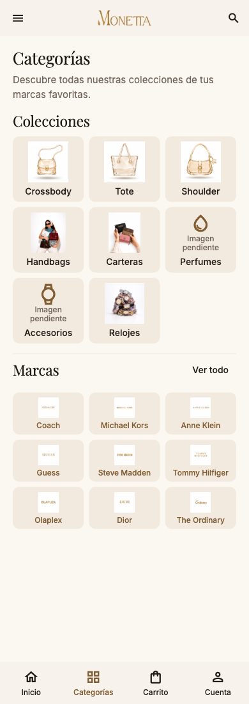

# Categorías — página 18

Antes: las categorías solo estaban en `catalog_browse_screen.dart` y los filtros. La guía pide un directorio con ocho colecciones ilustradas y una cuadrícula de marcas.

Implementado: pantalla dedicada `CategoriesScreen`, entrada `/categories` desde `openCategories`, ocho colecciones, marcas configuradas y «Ver todo / Ver menos». En teléfono usa tres columnas; tablet cuatro y escritorio seis, según los tokens. Con texto ampliado pasa a una columna para conservar la lectura. Los recursos ausentes muestran icono y «Imagen pendiente». Las etiquetas y logos tienen destino, foco y acción de Material.

| Colección | Destino existente |
|---|---|
| Crossbody | `CollectionScreen`, categoría `bolsa`, silueta `crossbody` |
| Tote | `CollectionScreen`, categoría `bolsa`, silueta `tote` |
| Shoulder | `CollectionScreen`, categoría `bolsa`, silueta `shoulder` |
| Handbags | `CollectionScreen`, categoría `bolsa`, términos `handbag / top handle / bolsa de mano` |
| Carteras | `CollectionScreen`, categoría `cartera` |
| Perfumes | `CollectionScreen`, categoría `perfume` |
| Accesorios | `CollectionScreen`, categoría `accesorio` |
| Relojes | `CollectionScreen`, categoría `reloj` |
| Marca | `BrandScreen`, identificador canónico resuelto con las reglas existentes, conservando el título editorial |

El menú general de Inicio incorpora «Categorías». La barra inferior de Inicio, Colección y Catálogo abre el directorio; conserva el identificador `catalog` y las keys existentes. Las barras de la guía de M2 y M3 abren la misma pantalla. La selección actual no duplica Categorías. Se mantienen el botón «Ver todo» del catálogo, búsqueda, filtros, productos, rutas de notificaciones y regreso del sistema. El menú de la guía añade Mayoreo y Contacto. No se tocó el archivo de rutas principal ni las pantallas de pagos, pedidos, checkout o Rewards.

Pendiente: arte exacto del PDF, fotografía de perfumes y accesorios. La cuadrícula respeta las doce marcas del contenido configurado/fallback, en lugar de inventar las nueve de la lámina. Handbags depende de los términos publicados del producto; no se agrega una taxonomía nueva al catálogo. No se afirma disponibilidad cuando una colección está vacía.

Pruebas: ocho accesos y regreso, marcas tras «Ver todo», navegación desde Inicio y Catálogo, menú de servicios, 320 px con texto al 200%, teléfono, tablet y oscuro. La comprobación de escala de la barra usa las fuentes reales empaquetadas para medir la etiqueta «Categorías».

[Tablet](screenshots/categories-834-light.png) · [Oscuro](screenshots/categories-390-dark.png)
