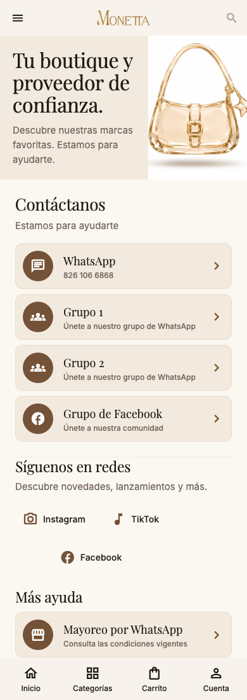

# Contacto — página 16

Antes: lista plana de WhatsApp, mayoreo, sitio y redes. La lámina pide portada editorial, cuatro tarjetas (WhatsApp, dos grupos y comunidad de Facebook), redes y navegación persistente.

Implementado: portada con asset existente, cuatro tarjetas de la guía, redes configuradas, accesos anteriores de ayuda y marcadores de horario, correo y línea de voz. El menú de Inicio abre esta pantalla. Los enlaces de grupos provienen de `PartnerHubScreen`: ahora se comparten desde `contact_links.dart`; no se agregaron destinos nuevos. WhatsApp mantiene el número de `shopper_copy.dart`. Las redes respetan la lista recibida o el contenido configurado/fallback; una lista vacía muestra un marcador sin inventar cuentas. No se enlaza el teléfono de WhatsApp como línea de voz. Fallos y excepciones del lanzador muestran un aviso.

Pendiente: fotografía y marca gráfica exactas; horario, correo y teléfono de voz verificados. Se conservan además los accesos de mayoreo y sitio web existentes bajo «Más ayuda». Las redes usan iconos de Material con etiqueta accesible, no los logotipos exactos del mockup.

Pruebas: destinos existentes, grupos, lista vacía, fallo de apertura y excepción; 320 px/texto 200%, teléfono, tablet y oscuro. Los lanzadores están sustituidos en pruebas, sin abrir chats, redes ni servicios.

[Tablet](screenshots/contact-834-light.png) · [Oscuro](screenshots/contact-390-dark.png)
