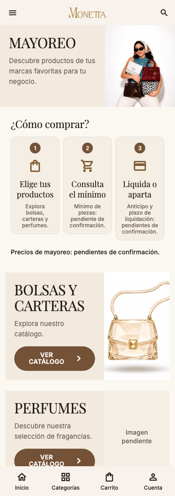
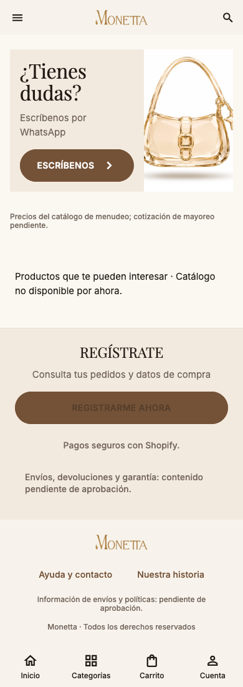

# Mayoreo y continuidad — páginas 10–11

Antes: portada oscura, condiciones y logística con importes fijos. La guía pide portada clara, pasos numerados, dos catálogos, servicios y continuación con WhatsApp, recomendaciones, registro y pie.

Implementado: esa secuencia completa con navegación a las colecciones existentes. Bolsas y carteras usa términos de ambas categorías; Perfumes aplica la categoría canónica. La cotización usa el número existente de `shopper_copy.dart`, sin aceptar mínimos, depósitos ni plazos en el mensaje. Un fallo del enlace muestra un aviso. Registro abre Cuenta si está disponible. Los productos recomendados usan el catálogo local existente; no se fabrica un ranking ni precios de mayoreo. Se distingue explícitamente su precio de menudeo de una cotización pendiente. Se muestra un estado vacío si no hay catálogo.

Se retiraron de esta presentación los términos fijos antiguos y la nota de Rewards; no se cambió la lógica de Rewards, pagos, pedidos ni apartados. Mínimo, precios, anticipo, liquidación y envío tienen marcadores visibles. No se trasladan a la app las cifras ilustrativas del PDF. La ruta antigua de socios sigue disponible desde Cuenta e Historia.

Pendiente: arte exacto de la portada y banners, foto de perfumes (marcador «Imagen pendiente»), tarifas y términos aprobados, newsletter y beneficio de envío gratis. No hay un flujo de compra mayorista nuevo: los accesos exploran el catálogo existente y WhatsApp solicita información.

Evidencia sin sesión, sin catálogo cargado y sin llamadas externas; en esta captura registro/cuenta están deshabilitados por ausencia del controlador. En la app se usa el controlador existente:

[Tablet](screenshots/wholesale-834-light.png) · [Oscuro](screenshots/wholesale-390-dark.png)
