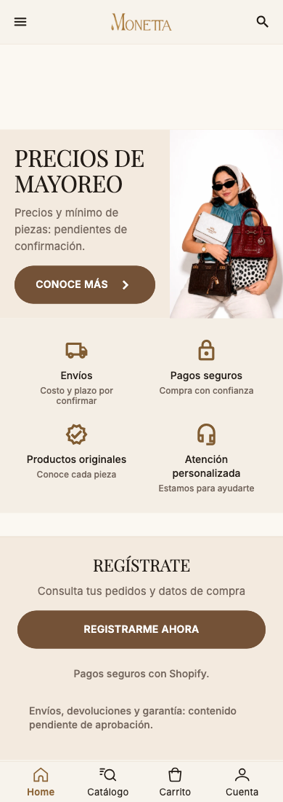
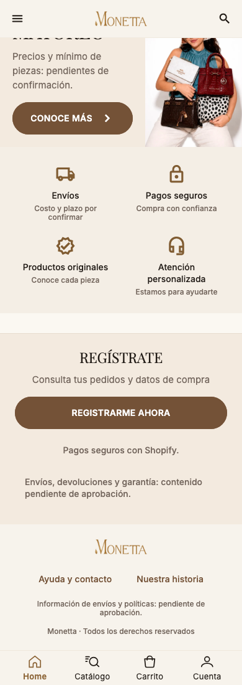

# Página principal (seguimiento) — página 4

Comparación comunicada antes de codificar: la lámina continúa Inicio con campaña, productos, mayoreo, cuatro servicios, registro y pie. Inicio ya tenía descubrimiento y módulos configurables; no tenía el banner de mayoreo, servicios ni pie de esta lámina.

Se reemplaza el carrusel promocional final por el banner de mayoreo (abre `WholesaleScreen`), seguido de servicios, registro y pie con contacto e historia. Se conservan los módulos y su orden publicado, productos/precios del catálogo y la apertura de Cuenta. La franja de servicios no publica mínimos, tarifas ni beneficios de envío. Registro no promete envío gratis ni simula una suscripción; abre la cuenta existente. Los textos y medidas nuevos usan los roles generados, con el adaptador de tema para oscuro.

Pendiente: foto Coach/campaña exacta, orden y densidad literal de la lámina (se conserva el contenido publicado), newsletter y oferta de envío gratis aprobadas, textos y enlaces específicos de políticas. No se fabrica popularidad para llamar «Lo más buscado» al catálogo.

El recorrido a 320 px con texto al 200% reveló dos desbordamientos del contenido anterior: el banner ahora aumenta su altura con el texto y la insignia de reseñas puede saltar de línea. Cambios de presentación en Inicio.

Evidencia de widgets con mercancía sintética (DEMO), assets locales y sin conexión a servicios:

[Tablet](screenshots/home-followup-834-light.png) · [Oscuro](screenshots/home-followup-390-dark.png)
